# 🗄️ Database Design & Data Architecture

> **Database Engines**: PostgreSQL 16 + TimescaleDB 2.17+ Extension + Redis 7 Stack  
> **ORM & Query Engine**: Prisma 6  
> **Status**: Approved & Implemented in `@repo/prisma`  

---

## 1. Entity-Relationship Diagram (ERD)

```mermaid
erDiagram
    users ||--o| profiles : "has one"
    users ||--o{ subscriptions : "holds"
    users ||--o{ security_flags : "triggers"
    users ||--o{ admin_audit_logs : "administers"
    plans ||--o{ subscriptions : "defines"
    profiles ||--o{ links : "has many"
    profiles ||--o{ social_links : "has many"
    profiles }o--o| themes : "uses preset"
    profiles ||--o| custom_themes : "has custom"
    profiles ||--o{ page_views : "receives"
    links ||--o{ click_events : "generates"

    users {
        uuid id PK "Default gen_random_uuid()"
        varchar email UK "Unique indexed email"
        varchar password_hash "Nullable for OAuth users"
        varchar name "User display name"
        varchar google_id UK "Unique Google OpenID"
        enum role "CREATOR, SUPER_ADMIN, OWNER"
        boolean is_banned "Suspension flag default false"
        timestamptz created_at "Default now()"
        timestamptz updated_at
        timestamptz deleted_at "Soft delete timestamp"
    }

    plans {
        uuid id PK
        varchar code UK "FREE, PRO, ENTERPRISE"
        varchar name "Display name"
        integer price_cents "E.g. 900 for $9.00/mo"
        varchar interval "MONTHLY, YEARLY"
        jsonb features "Tier limit flags (custom_domain, etc.)"
        varchar stripe_price_id UK "Stripe price identifier"
        boolean is_active "Default true"
        timestamptz created_at
    }

    subscriptions {
        uuid id PK
        uuid user_id FK
        uuid plan_id FK
        varchar stripe_customer_id
        varchar stripe_subscription_id UK
        enum status "ACTIVE, PAST_DUE, CANCELED, TRIALING"
        timestamptz current_period_end
        timestamptz created_at
        timestamptz updated_at
    }

    security_flags {
        uuid id PK
        uuid user_id FK "User who submitted the URL"
        text submitted_url "Target suspicious URL"
        decimal risk_score "Sentinel AI score 0.00 to 1.00"
        enum threat_type "PHISHING, MALWARE, CRYPTO_DRAINER, SPAM"
        decimal ai_confidence "Model confidence level 0.00-1.00"
        inet ip_address "Origin client IP"
        enum status "BLOCKED_AUTO, PENDING_REVIEW, RESOLVED_BENIGN, BANNED"
        uuid reviewed_by FK "Super Admin user id"
        text resolution_notes
        timestamptz created_at
    }

    domain_blocklist {
        uuid id PK
        varchar domain_pattern UK "E.g. *.drainer.xyz or bit.ly/*"
        varchar reason "Phishing campaign, Ransomware, etc."
        uuid added_by FK "Super Admin who added the ban"
        timestamptz created_at
    }

    admin_audit_logs {
        uuid id PK
        uuid admin_user_id FK "Super Admin or Owner performing action"
        varchar action "BAN_USER, BLOCK_DOMAIN, UPDATE_PLAN, UNPUBLISH_PROFILE"
        varchar target_type "USER, LINK, PROFILE, PLAN"
        uuid target_id "Identifier of target entity"
        text reason "Mandatory audit justification"
        jsonb metadata "Snapshot of state diff before/after"
        timestamptz created_at
    }

    profiles {
        uuid id PK
        uuid user_id FK,UK "One-to-one with user"
        varchar username UK "Indexed vanity slug (3-30 chars)"
        varchar title "Profile display title"
        varchar bio "Bio description (max 500 chars)"
        text avatar_url "CDN URL of processed avatar"
        uuid theme_id FK "References themes table"
        boolean is_published "Default false"
        varchar seo_title "Meta title (max 60 chars)"
        varchar seo_description "Meta desc (max 160 chars)"
        text og_image_url "Dynamic OG image URL"
        timestamptz created_at
        timestamptz updated_at
    }

    links {
        uuid id PK
        uuid profile_id FK "References profile"
        varchar title "Link label (max 200 chars)"
        text url "Target destination URL"
        enum type "LINK, HEADER, DIVIDER"
        integer position "Order priority index"
        text thumbnail_url "Optional icon/thumbnail"
        boolean is_active "Toggle visibility"
        bigint click_count "Cached aggregate counter"
        timestamptz created_at
        timestamptz updated_at
    }

    themes {
        uuid id PK
        varchar name "Theme label"
        enum bg_type "SOLID, GRADIENT, IMAGE"
        text bg_value "CSS color, gradient, or URL"
        enum btn_style "FILLED, OUTLINE, SHADOW, ROUNDED"
        varchar btn_color "Hex or rgba string"
        varchar btn_text_color "Hex or rgba string"
        varchar font_family "Google Font family"
        varchar text_color "Hex color code"
        boolean is_default "Default theme flag"
        text preview_url "Thumbnail of theme"
        timestamptz created_at
    }

    custom_themes {
        uuid id PK
        uuid profile_id FK,UK "One-to-one per profile"
        enum bg_type "SOLID, GRADIENT, IMAGE"
        text bg_value
        enum btn_style "FILLED, OUTLINE, SHADOW, ROUNDED"
        varchar btn_color
        varchar btn_text_color
        varchar font_family
        varchar text_color
        integer btn_radius "Border radius in px"
        timestamptz created_at
        timestamptz updated_at
    }

    social_links {
        uuid id PK
        uuid profile_id FK
        enum platform "INSTAGRAM, TIKTOK, YOUTUBE, etc."
        text url "Direct social profile URL"
        integer position "Display order"
        boolean is_active "Toggle visibility"
        timestamptz created_at
    }

    page_views {
        bigint id PK
        uuid profile_id FK
        timestamptz viewed_at "Partition key (Hypertable)"
        inet ip_address "Truncated anonymized IP"
        text user_agent
        text referrer
        char country "2-letter ISO code"
        boolean is_unique "Daily unique visitor flag"
        boolean is_bot "Crawler/bot flag"
    }

    click_events {
        bigint id PK
        uuid link_id FK
        uuid profile_id FK
        timestamptz clicked_at "Partition key (Hypertable)"
        inet ip_address "Truncated anonymized IP"
        text user_agent
        text referrer
        char country "2-letter ISO code"
        boolean is_bot "Crawler/bot flag"
    }
```



---

## 2. Data Dictionary & Table Specifications

### 2.1 `users` Table
Stores authentication credentials, RBAC role designations, and account lifecycle states.
- **`id`** (`UUID`, PK): Immutable unique identifier generated via `gen_random_uuid()`.
- **`email`** (`VARCHAR(255)`, UNIQUE, NOT NULL): User email address normalized to lowercase.
- **`password_hash`** (`VARCHAR(255)`, NULLABLE): Bcrypt hashed password (null for Google-only OAuth signups).
- **`google_id`** (`VARCHAR(255)`, UNIQUE, NULLABLE): Subject identifier from Google OAuth 2.0 token.
- **`role`** (`ENUM`, DEFAULT `'CREATOR'`): Role-Based Access Control: `'CREATOR'`, `'SUPER_ADMIN'`, or `'OWNER'`.
- **`is_banned`** (`BOOLEAN`, DEFAULT `false`): Suspension flag enforced by middleware to block login and unpublish vanity URL.

### 2.2 `plans` & `subscriptions` Tables (SaaS Monetization)
- **`plans`**: Canonical pricing catalog synchronized with Stripe Product Catalog. Supports customizable feature flags (e.g. `{"custom_domains": true, "max_links": 100, "priority_support": true}`).
- **`subscriptions`**: Tracks active Stripe customer subscriptions, lifecycle status (`ACTIVE`, `PAST_DUE`), and billing periods.

### 2.3 `security_flags` & `domain_blocklist` (OneLink Sentinel AI)
- **`security_flags`**: Real-time event log populated when the embedded ONNX engine intercepts a suspicious URL (`risk_score >= 0.75`). Stores threat classification (`PHISHING`, `CRYPTO_DRAINER`) and IP metadata for Super Admin audits.
- **`domain_blocklist`**: High-speed blacklist synchronized into Redis sets (`blocklist:domains`) for O(1) instantaneous rejection before tensor computation.

### 2.4 `admin_audit_logs` Table
- Tamper-evident ledger capturing all privileged Super Admin actions (account suspensions, domain blocks, plan price edits) with mandatory human justification strings.

### 2.5 `profiles` Table
Core vanity landing page entity.
- **`username`** (`VARCHAR(30)`, UNIQUE, NOT NULL): Indexed URL slug. Sanitized against `RESERVED_USERNAMES`.
- **`is_published`** (`BOOLEAN`, DEFAULT `false`): Controls public accessibility (`/@username`).
- **`theme_id`** (`UUID`, FK, NULLABLE): Foreign key pointing to curated `themes` table.
- **`seo_title` & `seo_description`**: Custom Open Graph metadata for rich social sharing cards.

### 2.6 `links` Table
Individual items displayed on the creator profile.
- **`profile_id`** (`UUID`, FK, NOT NULL): Cascades on profile deletion.
- **`type`** (`ENUM`): Discriminates between clickable `LINK`, text `HEADER`, and visual `DIVIDER`.
- **`position`** (`INTEGER`, NOT NULL, DEFAULT 0): Zero-indexed order on screen. Managed atomically via drag-and-drop.
- **`click_count`** (`BIGINT`, DEFAULT 0): Denormalized counter incremented atomically by BullMQ workers to avoid expensive `COUNT(*)` queries on dashboard views.

---

## 3. High-Throughput Analytics & TimescaleDB Hypertables

For tracking millions of events without degrading transactional database performance, `click_events` and `page_views` are partitioned time-series **Hypertables**:

```sql
-- Convert standard tables to 1-day chunk hypertables
SELECT create_hypertable('click_events', 'clicked_at', chunk_time_interval => INTERVAL '1 day');
SELECT create_hypertable('page_views', 'viewed_at', chunk_time_interval => INTERVAL '1 day');

-- Automatic compression policy: compress chunks older than 7 days
ALTER TABLE click_events SET (
  timescaledb.compress,
  timescaledb.compress_segmentby = 'profile_id, link_id',
  timescaledb.compress_orderby = 'clicked_at DESC'
);
SELECT add_compression_policy('click_events', INTERVAL '7 days');
```

### Continuous Aggregates (Real-time Materialized Views)

```sql
-- Hourly rollups for high-speed dashboard analytics
CREATE MATERIALIZED VIEW hourly_link_clicks
WITH (timescaledb.continuous) AS
SELECT
    link_id,
    profile_id,
    time_bucket('1 hour', clicked_at) AS hour,
    COUNT(*) as total_clicks,
    COUNT(DISTINCT ip_address) as unique_clicks
FROM click_events
WHERE is_bot = false
GROUP BY link_id, profile_id, time_bucket('1 hour', clicked_at);
```

---

## 4. Strategic Indexing Plan

| Table | Index Definition | Access Pattern Justification |
|---|---|---|
| `profiles` | `CREATE UNIQUE INDEX idx_profiles_username ON profiles(LOWER(username))` | **Hot path**: Case-insensitive vanity URL lookup on every public profile view |
| `links` | `CREATE INDEX idx_links_profile_position ON links(profile_id, position) WHERE is_active = true` | Fetches active links for a profile pre-sorted by position |
| `social_links` | `CREATE INDEX idx_social_links_profile ON social_links(profile_id, position) WHERE is_active = true` | Quick retrieval of social icons for profile headers |
| `click_events` | `CREATE INDEX idx_clicks_link_time ON click_events(link_id, clicked_at DESC)` | Powers link performance graphs over customizable date ranges |
