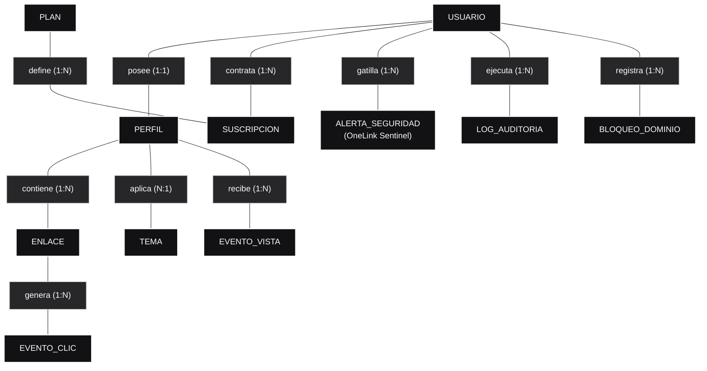
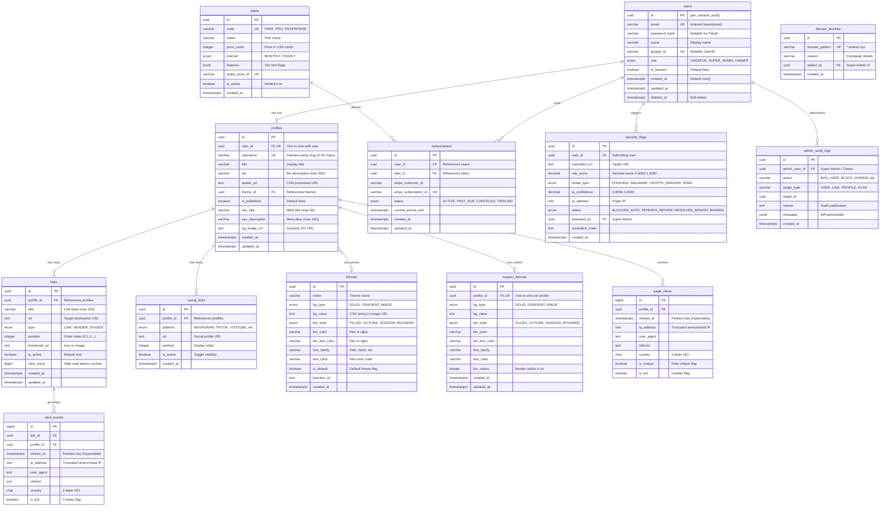

# 🗄️ Database Design & Data Architecture: De la Teoría a la Producción

> **Metodología de Modelado**: Arquitectura ANSI/SPARC de 3 Niveles (Conceptual Chen ➔ Lógico 3FN ➔ Físico Relacional)  
> **Motores de Datos**: PostgreSQL 16 + Extensión TimescaleDB 2.17+ + Redis 7 Stack  
> **ORM & Query Engine**: Prisma 6.4 (Tipado en `@repo/prisma`)  
> **Estado**: Aprobado, Sincronizado & Sembrado en Docker (`linktree_dev`)  

---

## 🏛️ Introducción Metodológica: Los 3 Niveles del Diseño de Datos

En la ingeniería de software y arquitectura de datos de clase mundial (siguiendo el estándar ANSI/SPARC), saltar directamente a escribir sentencias SQL o esquemas de ORM sin modelado previo es un antipatrón que genera incoherencias conceptuales y deuda técnica. 

Por eso, el diseño de datos de **OneLink** sigue rigurosamente los 3 niveles formales de abstracción:

```
┌────────────────────────────────────────────────────────────────────────────────────────┐
│ 1. MODELO CONCEPTUAL (Notación Peter Chen, 1976)                                       │
│    • 100% Agnóstico a la tecnología (SQL, NoSQL, ORM).                                │
│    • Define ENTIDADES semánticas del negocio, RELACIONES y CARDINALIDADES.             │
└────────────────────────────────────────┬───────────────────────────────────────────────┘
                                         │  (Traducción y Normalización)
                                         ▼
┌────────────────────────────────────────────────────────────────────────────────────────┐
│ 2. MODELO LÓGICO RELACIONAL (Edgar F. Codd, 1970)                                      │
│    • Aplica 1FN, 2FN, 3FN (Tercera Forma Normal) para evitar anomalías.                │
│    • Resuelve relaciones N:M, define Claves Primarias (PK) y Foráneas (FK).           │
│    • Documenta desnormalizaciones tácticas de alto rendimiento (click_count).         │
└────────────────────────────────────────┬───────────────────────────────────────────────┘
                                         │  (Optimización para el Motor)
                                         ▼
┌────────────────────────────────────────────────────────────────────────────────────────┐
│ 3. MODELO FÍSICO & RELACIONAL (PostgreSQL 16 + TimescaleDB + Prisma)                   │
│    • Tipos nativos (UUID, VARCHAR(30), TIMESTAMPTZ, INET, DECIMAL, JSONB).             │
│    • Particionamiento por tiempo (Hypertables 1 día) y compresión columnar.            │
│    • Índices B-Tree, índices parciales condicionales y políticas de integridad.        │
└────────────────────────────────────────────────────────────────────────────────────────┘
```

---

## 1. Nivel 1: Modelo Conceptual (Notación Semántica de Chen)

El modelo conceptual captura las entidades del mundo real y sus interacciones de negocio sin preocuparse por tablas, tipos de datos ni motores de almacenamiento:

### 1.1 Diagrama Entidad-Relación Conceptual (Estilo Chen)



### 1.2 Reglas de Negocio Semánticas
1. **Unicidad de Perfil**: Todo `USUARIO` creador posee exactamente un `PERFIL` público asociado (`1:1`).
2. **Suscripción Activa**: Un `USUARIO` puede contratar planes a lo largo del tiempo, pero en un momento dado solo una `SUSCRIPCION` rige sus privilegios (`1:N` histórico).
3. **Integridad de Catálogo**: Un `PLAN` (Free, Pro, Enterprise) define las características y límites de múltiples `SUSCRIPCION`.
4. **Defensa Sentinel AI**: Cuando un `USUARIO` intenta guardar un enlace sospechoso, el motor in-process gatilla una `ALERTA_SEGURIDAD` (`1:N`).
5. **Telemetría de Alto Rendimiento**: Un `ENLACE` genera millones de `EVENTO_CLIC` a lo largo del tiempo (`1:N`).

---

## 2. Nivel 2: Modelo Lógico Normalizado (3FN & Reglas de Codd)

El modelo lógico traduce las entidades conceptuales a relaciones estructuradas (tablas), definiendo claves primarias (`PK`), claves foráneas (`FK`), y garantizando la **Tercera Forma Normal (3FN)**:

### 2.1 Justificación de Normalización (1FN, 2FN, 3FN)

* **Primera Forma Normal (1FN - Atomicidad)**:
  * Todos los atributos contienen valores atómicos indivisibles.
  * *Aplicación*: Las redes sociales no se guardan como un array o cadena separada por comas dentro de `profiles`. Se extrajeron a la entidad `social_links` con campos independientes (`platform`, `url`, `position`).
* **Segunda Forma Normal (2FN - Dependencia Funcional Completa)**:
  * La base de datos está en 1FN y ningún atributo no clave depende de un subconjunto de una clave primaria compuesta.
  * *Aplicación*: Todas las entidades utilizan identificadores primarios simples `UUID` generados criptográficamente (`id PK`), eliminando cualquier riesgo de dependencia parcial.
* **Tercera Forma Normal (3FN - No Transitividad)**:
  * La base de datos está en 2FN y ningún atributo no clave depende transitivamente de otro atributo no clave.
  * *Aplicación*: El precio mensual (`price_cents`) y las características de suscripción no se guardan en `subscriptions`, sino en `plans`. Si un plan cambia de precio, no se modifica la tupla de suscripción del usuario, evitando anomalías de actualización.

### 2.2 Desnormalizaciones Tácticas de Alto Rendimiento (High-Read Optimization)

En arquitecturas de alta escala (High-Throughput), la pureza académica de la 3FN a veces choca con las latencias de lectura masivas. En OneLink implementamos dos desnormalizaciones conscientes y documentadas:

1. **`links.click_count` (BIGINT)**:
   * *Teoría pura*: Debería calcularse con `SELECT COUNT(*) FROM click_events WHERE link_id = ?`.
   * *Problema*: Ejecutar un agregador sobre una tabla con 10 millones de filas cada vez que un creador entra a su dashboard causaría contención masiva de I/O en disco.
   * *Solución*: Mantenemos `click_count` en la fila de `links`. BullMQ acumula lotes de clics en Redis y actualiza el contador de forma atómica cada 10 segundos.
2. **`plans.features` y `admin_audit_logs.metadata` (JSONB)**:
   * Permite extensibilidad dinámica de feature flags (`{"custom_domains": true, "sentinel_ai_pro": true}`) sin requerir migraciones DDL de esquema bloqueantes en producción.

---

## 3. Nivel 3: Modelo Físico & Relacional (Crows Foot ERD + PostgreSQL + TimescaleDB)

El modelo físico detalla los tipos de datos exactos, constraints a nivel de motor, hypertables de series temporales y estrategias de indexación:



---

## 4. Particionamiento TimescaleDB (Hypertables) & Compresión Columnar

Para garantizar que millones de eventos de telemetría no saturen el almacenamiento ni degraden los tiempos de consulta del creador:

```sql
-- 1. Conversión a Hypertables particionadas por día
SELECT create_hypertable('click_events', 'clicked_at', chunk_time_interval => INTERVAL '1 day');
SELECT create_hypertable('page_views', 'viewed_at', chunk_time_interval => INTERVAL '1 day');

-- 2. Compresión Columnar automática para fragmentos mayores a 7 días
ALTER TABLE click_events SET (
  timescaledb.compress,
  timescaledb.compress_segmentby = 'profile_id, link_id',
  timescaledb.compress_orderby = 'clicked_at DESC'
);
SELECT add_compression_policy('click_events', INTERVAL '7 days');

-- 3. Vista Materializada Continua para métricas por hora
CREATE MATERIALIZED VIEW hourly_link_clicks
WITH (timescaledb.continuous) AS
SELECT
    link_id,
    profile_id,
    time_bucket('1 hour', clicked_at) AS hour,
    COUNT(*) as total_clicks,
    COUNT(DISTINCT ip_address) as unique_clicks
FROM click_events
WHERE is_bot = false
GROUP BY link_id, profile_id, time_bucket('1 hour', clicked_at);
```

---

## 5. Plan Estratégico de Indexación

| Tabla | Definición del Índice | Patrón de Acceso Justificado |
|---|---|---|
| `profiles` | `CREATE UNIQUE INDEX idx_profiles_username ON profiles(LOWER(username))` | **Hot Path**: Resolución instantánea (<1ms) de slugs de creador en `/@username` |
| `links` | `CREATE INDEX idx_links_profile_position ON links(profile_id, position) WHERE is_active = true` | Índice parcial: Carga ultra-rápida de enlaces activos ordenados por posición |
| `security_flags` | `CREATE INDEX idx_security_flags_risk ON security_flags(risk_score DESC, created_at DESC)` | Alimenta la cola de moderación del Super Admin priorizando amenazas críticas |
| `domain_blocklist` | `CREATE UNIQUE INDEX idx_blocklist_pattern ON domain_blocklist(domain_pattern)` | Búsqueda y sincronización instantánea con los sets de Redis |
| `click_events` | `CREATE INDEX idx_clicks_link_time ON click_events(link_id, clicked_at DESC)` | Rango de fechas para las gráficas analíticas del estudio |
