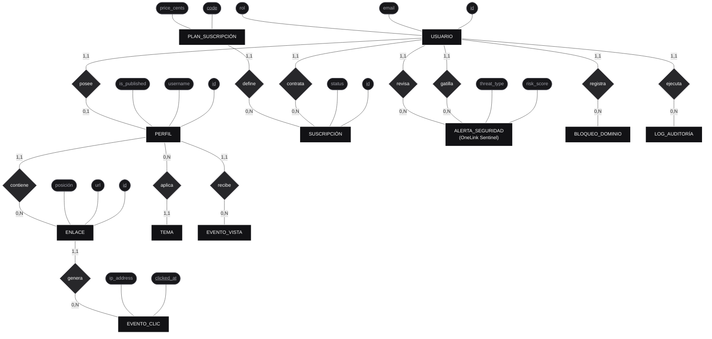
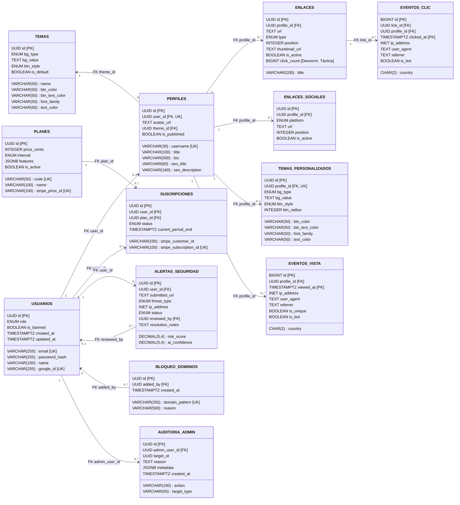

# 🗄️ Database Design & Data Architecture: De la Teoría a la Producción

> **Metodología de Modelado**: Arquitectura ANSI/SPARC de 3 Niveles (Conceptual Chen ➔ Lógico Relacional 3FN ➔ Físico Hypertables)  
> **Motores de Datos**: PostgreSQL 16 + Extensión TimescaleDB 2.17+ + Redis 7 Stack  
> **ORM & Query Engine**: Prisma 6.4 (Tipado en `@repo/prisma`)  
> **Estado**: Aprobado, Sincronizado & Sembrado en Docker (`linktree_dev`)  

---

## 🏛️ Introducción Metodológica: Los 3 Niveles del Diseño de Datos

En la ingeniería de software y arquitectura de datos de clase mundial (siguiendo el estándar ANSI/SPARC), saltar directamente a escribir sentencias SQL o esquemas de ORM sin modelado previo es un antipatrón que genera incoherencias conceptuales y deuda técnica. 

Por eso, el diseño de datos de **OneLink** sigue rigurosamente los 3 niveles formales de abstracción con sus respectivos diagramas y especificaciones:

```
┌────────────────────────────────────────────────────────────────────────────────────────┐
│ 1. MODELO CONCEPTUAL (Notación Peter Chen, 1976)                                       │
│    • 100% Agnóstico a la tecnología (SQL, NoSQL, ORM).                                │
│    • Define ENTIDADES semánticas del negocio, RELACIONES, ATRIBUTOS y CARDINALIDADES.  │
└────────────────────────────────────────┬───────────────────────────────────────────────┘
                                         │  (Traducción y Normalización 3FN)
                                         ▼
┌────────────────────────────────────────────────────────────────────────────────────────┐
│ 2. MODELO LÓGICO RELACIONAL (Edgar F. Codd, 1970)                                      │
│    • Aplica 1FN, 2FN, 3FN (Tercera Forma Normal) para evitar anomalías.                │
│    • Resuelve relaciones N:M, define Claves Primarias (PK) y Foráneas (FK).           │
│    • Diagrama de Clases / Estructura Lógica de Tablas e Integridad Referencial.        │
│    • Documenta desnormalizaciones tácticas de alto rendimiento (click_count).         │
└────────────────────────────────────────┬───────────────────────────────────────────────┘
                                         │  (Optimización de Motor, Índices y Partición)
                                         ▼
┌────────────────────────────────────────────────────────────────────────────────────────┐
│ 3. MODELO FÍSICO & RELACIONAL (PostgreSQL 16 + TimescaleDB + Prisma DDL)               │
│    • Diagrama Crow's Foot con tipos nativos (UUID, VARCHAR, TIMESTAMPTZ, INET, JSONB). │
│    • Particionamiento por tiempo (Hypertables 1 día) y compresión columnar.            │
│    • Índices B-Tree, índices parciales condicionales y políticas de integridad.        │
└────────────────────────────────────────────────────────────────────────────────────────┘
```

---

## 1. Nivel 1: Modelo Conceptual (Notación Semántica de Peter Chen)

El modelo conceptual captura las entidades del mundo real y sus interacciones de negocio sin preocuparse por tablas, tipos de datos ni motores de almacenamiento.

### 1.1 Diagrama Entidad-Relación Conceptual Completo (Estilo Chen)

En la notación clásica de Peter Chen:
* **Rectángulos**: Entidades del Dominio (Sustantivos del Negocio).
* **Rombos**: Relaciones Semánticas (Verbos y Acciones).
* **Óvalos / Elipses**: Atributos Principales (con Claves Primarias Candidatas subrayadas `<u>id</u>`).
* **Líneas con Etiquetas**: Cardinalidades Mínimas y Máximas `(min, max)` como `(1,1)`, `(0,1)`, `(1,N)`, `(0,N)`.



### 1.2 Diccionario Semántico y Reglas de Negocio
1. **Regla de Identidad y Perfil (1:1)**: Un `USUARIO` creador posee exactamente cero o un `PERFIL` público (`/@username`). No se permite la tenencia de múltiples perfiles con la misma cuenta en el tier gratuito para evitar squatting de vanity URLs.
2. **Regla de Monopolio de Tema (N:1)**: Un `PERFIL` aplica exactamente un `TEMA` predeterminado del sistema o un tema personalizado. Múltiples perfiles pueden compartir el mismo preset (`Obsidian Kinetic`, `Carbon Architecture`, etc.).
3. **Regla de Contratación y Facturación (1:N)**: Un `USUARIO` puede generar múltiples `SUSCRIPCIÓN` a lo largo de su ciclo de vida (Free ➔ Pro ➔ Cancelado ➔ Pro), pero solo una está activa en un instante dado. Un `PLAN_SUSCRIPCIÓN` define los límites y precio de miles de suscripciones.
4. **Regla de Seguridad Activa OneLink Sentinel (1:N)**: Cuando un `USUARIO` intenta guardar un enlace cuya heurística o tensor ONNX detecta peligro (`risk_score >= 0.75`), se gatilla una `ALERTA_SEGURIDAD` inmutable.
5. **Regla de Moderación y Auditoría (1:N)**: Un `USUARIO` con rol `SUPER_ADMIN` revisa las alertas de seguridad y ejecuta acciones registradas en `LOG_AUDITORÍA`.
6. **Regla de Telemetría Masiva (1:N)**: Un `ENLACE` genera potencialmente millones de `EVENTO_CLIC`. Los clics se registran de forma asíncrona sin bloquear la redirección del visitante.

---

## 2. Nivel 2: Modelo Lógico Relacional (Diagrama de Estructuras & 3FN)

El modelo lógico traduce las entidades conceptuales a **relaciones formales (esquema de tablas)**, definiendo las Claves Primarias (`PK`), Claves Foráneas (`FK`), y demostrando el cumplimiento riguroso de la **Tercera Forma Normal (3FN)** de Edgar Codd.

### 2.1 Diagrama Lógico Relacional de Estructura de Tablas



### 2.2 Proceso Formal de Normalización (1FN, 2FN, 3FN)

A continuación se demuestra matemáticamente cómo el esquema lógico de OneLink alcanza la **Tercera Forma Normal (3FN)** sin anomalías:

#### 1. Primera Forma Normal (1FN) — Atomicidad de Dominios
* **Definición**: Todos los atributos contienen únicamente valores atómicos indivisibles; no existen grupos repetitivos ni arrays no escalables.
* **Violación Típica**: Guardar una lista de redes sociales o múltiples URLs dentro de una sola celda como `social_links: "ig:alex,tk:alex,yt:alex"`.
* **Solución OneLink**: Se desacopló la entidad `social_links`, donde cada fila almacena una única tupla atómica: `(id, profile_id, platform, url, position, is_active)`. De igual forma, los enlaces son entidades independientes asociadas por Clave Foránea (`profile_id`).

#### 2. Segunda Forma Normal (2FN) — Dependencia Funcional Completa
* **Definición**: La relación está en 1FN y cada atributo no clave depende funcionalmente de la **totalidad** de la Clave Primaria, no de una parte de una clave compuesta.
* **Demostración de Dependencias Funcionales (DF)**:
  * En `USUARIOS`: `id ➔ {email, password_hash, name, google_id, role, is_banned}`
  * En `PERFILES`: `id ➔ {user_id, username, title, bio, theme_id, is_published}`
  * En `ENLACES`: `id ➔ {profile_id, title, url, type, position, is_active}`
* Como todas las tablas transaccionales utilizan Claves Primarias Simples (`UUID id`), **no existen claves compuestas parciales en las tablas del núcleo transaccional**, cumpliendo la 2FN por definición estructural.
* En las tablas de eventos (`click_events`), la clave compuesta es `(id, clicked_at)` por requerimiento del particionamiento por rangos temporales de TimescaleDB.

#### 3. Tercera Forma Normal (3FN) — No Dependencia Transitiva
* **Definición**: La relación está en 2FN y no existen atributos no clave que dependan funcionalmente de otros atributos no clave (es decir, si `A ➔ B` y `B ➔ C`, entonces `C` debe residir en su propia relación).
* **Violación Típica**: Almacenar en la tabla `subscriptions` el nombre del plan y su precio: `(id, user_id, plan_name, price_cents)`. Si el precio del plan cambia, se tendrían que actualizar miles de registros de suscripción (anomalía de modificación).
* **Solución OneLink**: Se crea la relación `PLANES` (`code ➔ {name, price_cents, interval}`). La relación `SUSCRIPCIONES` contiene únicamente la clave foránea `plan_id`. Si el precio de un plan cambia en Stripe, solo se actualiza una única tupla en `PLANES`.

### 2.3 Desnormalizaciones Tácticas de Alto Rendimiento Justificadas

En sistemas distribuidos de alto tráfico, la adhesión dogmática a la 3FN puede degradar severamente la latencia en operaciones de lectura intensa (*Read-Heavy Workloads*). OneLink aplica dos desnormalizaciones conscientes:

| Campo Desnormalizado | Tabla | Forma Normal Estricta | Justificación de Ingeniería (High-Throughput) | Mecanismo de Consistencia |
|---|---|---|---|---|
| **`click_count`** (`BIGINT`) | `links` | Violación 3FN (es un valor derivado de `click_events`) | Si un perfil recibe 50,000 clics diarios, calcular `COUNT(*)` en el dashboard del creador generaría lecturas secuenciales masivas en disco. | BullMQ acumula contadores en memoria en Redis y ejecuta un `UPDATE links SET click_count = click_count + batch` cada 10s. |
| **`features`** (`JSONB`) | `plans` | Violación 1FN (objeto estructurado no relacional) | Permite añadir nuevas banderas de suscripción (`custom_domains`, `sentinel_ai_pro`, `max_links`) sin requerir migraciones DDL de esquema bloqueantes en PostgreSQL en caliente. | Validación rígida en tiempo de ejecución garantizada por Zod en `@repo/shared`. |
| **`metadata`** (`JSONB`) | `admin_audit_logs` | Violación 1FN | Almacena el snapshot diferencial (diff before/after) de cualquier entidad modificada por el Super Admin sin requerir una tabla por cada tipo de entidad del sistema. | Ledger de auditoría inmutable (solo `INSERT`, nunca `UPDATE` ni `DELETE`). |

---

## 3. Nivel 3: Modelo Físico & Relacional (Crow's Foot ERD + PostgreSQL + TimescaleDB)

El modelo físico implementa las estructuras relacionales optimizadas para los motores de almacenamiento **PostgreSQL 16** (transaccional ACID) y **TimescaleDB** (series temporales distribuidas):

### 3.1 Diagrama Crow's Foot Físico de Base de Datos


---

## 4. Particionamiento TimescaleDB (Hypertables) & Compresión Columnar

Para garantizar que millones de eventos de telemetría no saturen el almacenamiento ni degraden los tiempos de consulta del creador:

```sql
-- 1. Conversión a Hypertables particionadas por día
SELECT create_hypertable('click_events', 'clicked_at', chunk_time_interval => INTERVAL '1 day');
SELECT create_hypertable('page_views', 'viewed_at', chunk_time_interval => INTERVAL '1 day');

-- 2. Compresión Columnar automática para fragmentos mayores a 7 días
ALTER TABLE click_events SET (
  timescaledb.compress,
  timescaledb.compress_segmentby = 'profile_id, link_id',
  timescaledb.compress_orderby = 'clicked_at DESC'
);
SELECT add_compression_policy('click_events', INTERVAL '7 days');

-- 3. Vista Materializada Continua para métricas por hora
CREATE MATERIALIZED VIEW hourly_link_clicks
WITH (timescaledb.continuous) AS
SELECT
    link_id,
    profile_id,
    time_bucket('1 hour', clicked_at) AS hour,
    COUNT(*) as total_clicks,
    COUNT(DISTINCT ip_address) as unique_clicks
FROM click_events
WHERE is_bot = false
GROUP BY link_id, profile_id, time_bucket('1 hour', clicked_at);
```

---

## 5. Plan Estratégico de Indexación

| Tabla | Definición del Índice | Patrón de Acceso Justificado |
|---|---|---|
| `profiles` | `CREATE UNIQUE INDEX idx_profiles_username ON profiles(LOWER(username))` | **Hot Path**: Resolución instantánea (<1ms) de slugs de creador en `/@username` |
| `links` | `CREATE INDEX idx_links_profile_position ON links(profile_id, position) WHERE is_active = true` | Índice parcial: Carga ultra-rápida de enlaces activos ordenados por posición |
| `security_flags` | `CREATE INDEX idx_security_flags_risk ON security_flags(risk_score DESC, created_at DESC)` | Alimenta la cola de moderación del Super Admin priorizando amenazas críticas |
| `domain_blocklist` | `CREATE UNIQUE INDEX idx_blocklist_pattern ON domain_blocklist(domain_pattern)` | Búsqueda y sincronización instantánea con los sets de Redis |
| `click_events` | `CREATE INDEX idx_clicks_link_time ON click_events(link_id, clicked_at DESC)` | Rango de fechas para las gráficas analíticas del estudio |
