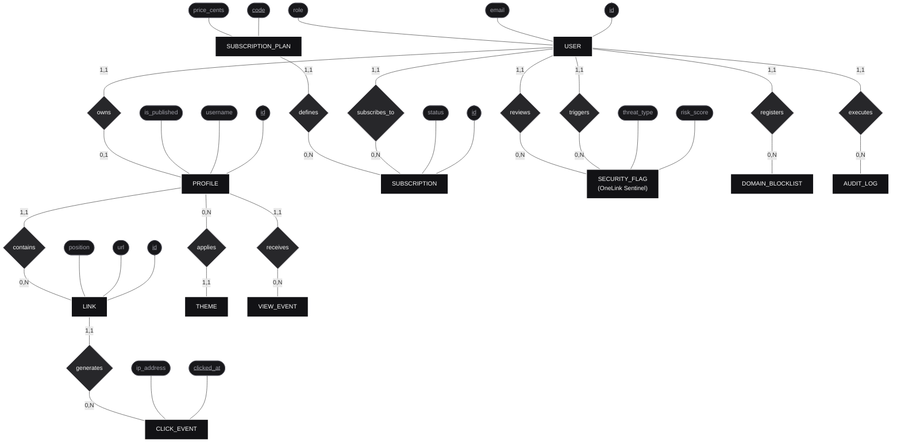

# 🗄️ Database Design & Data Architecture: From Theory to Production

> **Modeling Methodology**: ANSI/SPARC 3-Schema Architecture (Conceptual Chen ➔ Logical Relational 3NF ➔ Physical Hypertables)  
> **Database Engines**: PostgreSQL 16 + TimescaleDB 2.17+ Extension + Redis 7 Stack  
> **ORM & Query Engine**: Prisma 6.4 (Typed in `@repo/prisma`)  
> **Status**: Approved, Synchronized & Seeded in Docker (`linktree_dev`)  

---

## 🏛️ Methodological Introduction: The 3 Levels of Data Modeling

In enterprise software engineering and world-class data architecture (following the ANSI/SPARC standard), jumping straight to writing SQL statements or ORM schemas without prior modeling is an anti-pattern that creates conceptual inconsistencies, maintenance bottlenecks, and technical debt.

For this reason, the **OneLink** data architecture strictly adheres to the 3 formal levels of abstraction with complete diagrams and technical specifications:

```
┌────────────────────────────────────────────────────────────────────────────────────────┐
│ 1. CONCEPTUAL DATA MODEL (Peter Chen Notation, 1976)                                   │
│    • 100% Technology-Agnostic (Independent of SQL, NoSQL, ORMs).                      │
│    • Defines Business Entities, Semantic Relationships, Attributes, and Cardinalities. │
└────────────────────────────────────────┬───────────────────────────────────────────────┘
                                         │  (Translation & 3NF Normalization)
                                         ▼
┌────────────────────────────────────────────────────────────────────────────────────────┐
│ 2. LOGICAL RELATIONAL MODEL (Edgar F. Codd, 1970)                                      │
│    • Applies 1NF, 2NF, 3NF (Third Normal Form) to eliminate data anomalies.           │
│    • Resolves M:N relationships, defines Primary Keys (PK) and Foreign Keys (FK).      │
│    • Class Structure Diagram of Relational Tables and Referential Integrity.           │
│    • Documents high-throughput tactical denormalizations (e.g., click_count).         │
└────────────────────────────────────────┬───────────────────────────────────────────────┘
                                         │  (Engine Optimization, Indexes & Hypertables)
                                         ▼
┌────────────────────────────────────────────────────────────────────────────────────────┐
│ 3. PHYSICAL RELATIONAL MODEL (PostgreSQL 16 + TimescaleDB + Prisma DDL)                │
│    • Crow's Foot Diagram with native engine types (UUID, VARCHAR, TIMESTAMPTZ, JSONB). │
│    • Time-series partitioning (1-day chunk Hypertables) & columnar compression.        │
│    • Strategic B-Tree indexes, partial conditional indexes, and foreign constraints.   │
└────────────────────────────────────────────────────────────────────────────────────────┘
```

---

## 1. Level 1: Conceptual Data Model (Peter Chen Semantic Notation)

The conceptual model captures real-world business entities and their interactions without concern for table implementations, data storage formats, or physical database engines.

### 1.1 Complete Conceptual Entity-Relationship Diagram (Chen Style)

In classic Peter Chen notation:
* **Rectangles**: Domain Entities (Business Nouns).
* **Diamonds**: Semantic Relationships (Actions and Verbs).
* **Ovals / Ellipses**: Key Attributes (with Primary Key Candidates underlined `<u>id</u>`).
* **Labeled Edges**: Minimum and Maximum Cardinalities `(min, max)` such as `(1,1)`, `(0,1)`, `(1,N)`, `(0,N)`.



### 1.2 Semantic Business Rules & Invariants
1. **Profile Identity Invariant (1:1)**: A creator `USER` owns exactly zero or one public `PROFILE` (`/@username`). Free-tier accounts cannot create multiple profiles, preventing vanity URL squatting.
2. **Theme Consistency Invariant (N:1)**: A `PROFILE` applies exactly one curated preset `THEME` or custom theme. Many profiles can share the same preset (`Obsidian Kinetic`, `Carbon Architecture`, etc.).
3. **Subscription Lifecycle Rule (1:N)**: A `USER` may hold multiple `SUBSCRIPTION` records across time (Free ➔ Pro ➔ Canceled ➔ Pro), but only one subscription remains active at any given point. A `SUBSCRIPTION_PLAN` governs feature gates and pricing for thousands of subscriptions.
4. **OneLink Sentinel AI Defense Rule (1:N)**: When a `USER` submits a destination link whose lexical heuristics or ONNX tensor scores indicate danger (`risk_score >= 0.75`), an immutable `SECURITY_FLAG` is created.
5. **Super Admin Governance Rule (1:N)**: A `USER` with the `SUPER_ADMIN` role reviews security flags and logs disciplinary actions to `AUDIT_LOG`.
6. **High-Throughput Telemetry Invariant (1:N)**: A `LINK` generates potentially millions of `CLICK_EVENT` records. Telemetry writes are decoupled from redirect latency.

---

## 2. Level 2: Logical Relational Model (Class Diagram & 3NF Normalization)

The logical model maps conceptual entities into **formal relational structures (tables)**, specifying Primary Keys (`PK`), Foreign Keys (`FK`), and proving compliance with Edgar F. Codd's **Third Normal Form (3NF)**.

### 2.1 Logical Relational Structure Diagram


### 2.2 Formal Normalization Analysis (1NF, 2NF, 3NF)

Below is the formal proof of how the OneLink relational schema satisfies **Third Normal Form (3NF)** without redundancy or anomalies:

#### 1. First Normal Form (1NF) — Domain Atomicity
* **Requirement**: All attributes must hold atomic, indivisible values. No repeating groups or unindexed arrays.
* **Classical Pitfall**: Storing social media handles or multiple links inside a single cell (e.g., `social_links: "ig:alex,tk:alex,yt:alex"`).
* **OneLink Solution**: Decoupled into `social_links`, where each row stores an atomic tuple: `(id, profile_id, platform, url, position, is_active)`. Similarly, creator links are distinct rows linked via Foreign Key (`profile_id`).

#### 2. Second Normal Form (2NF) — Full Functional Dependency
* **Requirement**: The relation is in 1NF and every non-key attribute is fully functionally dependent on the **entire** Primary Key, rather than on a subset of a composite key.
* **Functional Dependencies (FD)**:
  * In `USERS`: `id ➔ {email, password_hash, name, google_id, role, is_banned}`
  * In `PROFILES`: `id ➔ {user_id, username, title, bio, theme_id, is_published}`
  * In `LINKS`: `id ➔ {profile_id, title, url, type, position, is_active}`
* Because every core transactional table utilizes a single-column cryptographic `UUID` Primary Key (`id PK`), **partial key dependencies are mathematically impossible**, satisfying 2NF by design.
* In event telemetry tables (`click_events`, `page_views`), the composite key `(id, clicked_at)` is strictly necessary for TimescaleDB partition chunking.

#### 3. Third Normal Form (3NF) — Non-Transitive Dependency
* **Requirement**: The relation is in 2NF and no non-key attribute is transitively dependent on another non-key attribute (i.e., if `A ➔ B` and `B ➔ C`, then `C` must live in its own relation).
* **Classical Pitfall**: Storing plan tier names and monthly prices inside the `subscriptions` table: `(id, user_id, plan_name, price_cents)`. If a plan price updates in Stripe, thousands of subscription rows would require updates (update anomaly).
* **OneLink Solution**: The `PLANS` relation encapsulates pricing (`code ➔ {name, price_cents, interval}`). The `SUBSCRIPTIONS` relation stores only the foreign key `plan_id`. Price adjustments update a single canonical tuple.

### 2.3 Deliberate High-Throughput Denormalizations

In high-traffic distributed architectures, dogmatic adherence to 3NF can compromise read latencies. OneLink incorporates two documented, tactical denormalizations:

| Denormalized Field | Target Table | Strict Normal Form Status | Engineering Rationale (High-Throughput Read SLA) | Consistency Mechanism |
|---|---|---|---|---|
| **`click_count`** (`BIGINT`) | `links` | Violates 3NF (derived attribute of `click_events`) | If a creator receives 50,000 daily clicks, computing `COUNT(*)` on every dashboard visit triggers heavy I/O disk scans. | BullMQ batches memory increments in Redis and executes an atomic `UPDATE links SET click_count = click_count + batch` every 10s. |
| **`features`** (`JSONB`) | `plans` | Violates 1NF (structured non-scalar document) | Enables adding new subscription feature flags (`custom_domains`, `sentinel_ai_pro`, `max_links`) without blocking DDL schema migrations in production PostgreSQL. | Strict runtime typing validated via Zod schemas in `@repo/shared`. |
| **`metadata`** (`JSONB`) | `admin_audit_logs` | Violates 1NF | Stores state diff snapshots (before/after) of modified entities without creating dedicated audit tables for each domain model. | Immutable append-only ledger (`INSERT` only; never `UPDATE` or `DELETE`). |

---

## 3. Level 3: Physical Relational Model (Crow's Foot ERD + PostgreSQL + TimescaleDB)

The physical model specifies concrete storage representations optimized for **PostgreSQL 16** (ACID transactional integrity) and **TimescaleDB** (scalable time-series telemetry):

### 3.1 Physical Crow's Foot Database Diagram

```mermaid
erDiagram
    users ||--o| profiles : "1:1 user_id"
    users ||--o{ subscriptions : "1:N user_id"
    users ||--o{ security_flags : "1:N user_id"
    users ||--o{ admin_audit_logs : "1:N admin_user_id"
    plans ||--o{ subscriptions : "1:N plan_id"
    profiles ||--o{ links : "1:N profile_id"
    profiles ||--o{ social_links : "1:N profile_id"
    profiles }o--o| themes : "N:1 theme_id"
    profiles ||--o| custom_themes : "1:1 profile_id"
    profiles ||--o{ page_views : "1:N profile_id"
    links ||--o{ click_events : "1:N link_id"

    users {
        uuid id PK "gen_random_uuid()"
        varchar email UK "Indexed lower(email)"
        varchar password_hash "Nullable for OAuth"
        varchar name "Display name"
        varchar google_id UK "Nullable OpenID"
        enum role "CREATOR, SUPER_ADMIN, OWNER"
        boolean is_banned "Default false"
        timestamptz created_at "Default now()"
        timestamptz updated_at
        timestamptz deleted_at "Soft delete"
    }

    plans {
        uuid id PK
        varchar code UK "FREE, PRO, ENTERPRISE"
        varchar name "Plan name"
        integer price_cents "Price in USD cents"
        enum interval "MONTHLY, YEARLY"
        jsonb features "Tier limit flags"
        varchar stripe_price_id UK
        boolean is_active "Default true"
        timestamptz created_at
    }

    subscriptions {
        uuid id PK
        uuid user_id FK "References users(id)"
        uuid plan_id FK "References plans(id)"
        varchar stripe_customer_id
        varchar stripe_subscription_id UK
        enum status "ACTIVE, PAST_DUE, CANCELED, TRIALING"
        timestamptz current_period_end
        timestamptz created_at
        timestamptz updated_at
    }

    security_flags {
        uuid id PK
        uuid user_id FK "References users(id)"
        text submitted_url "Target URL"
        decimal risk_score "Sentinel score (5,4)"
        enum threat_type "PHISHING, MALWARE, CRYPTO_DRAINER, SPAM"
        decimal ai_confidence "(5,4)"
        inet ip_address "Origin IP"
        enum status "BLOCKED_AUTO, PENDING_REVIEW, RESOLVED_BENIGN, BANNED"
        uuid reviewed_by FK "References users(id)"
        text resolution_notes
        timestamptz created_at
    }

    domain_blocklist {
        uuid id PK
        varchar domain_pattern UK "*.drainer.xyz"
        varchar reason "Campaign details"
        uuid added_by FK "References users(id)"
        timestamptz created_at
    }

    admin_audit_logs {
        uuid id PK
        uuid admin_user_id FK "References users(id)"
        varchar action "BAN_USER, BLOCK_DOMAIN, etc."
        varchar target_type "USER, LINK, PROFILE, PLAN"
        uuid target_id
        text reason "Audit justification"
        jsonb metadata "Diff before/after"
        timestamptz created_at
    }

    profiles {
        uuid id PK
        uuid user_id FK,UK "References users(id)"
        varchar username UK "Indexed vanity slug (3-30 chars)"
        varchar title "Display title"
        varchar bio "Bio description (max 500)"
        text avatar_url "CDN processed URL"
        uuid theme_id FK "References themes(id)"
        boolean is_published "Default false"
        varchar seo_title "Meta title (max 60)"
        varchar seo_description "Meta desc (max 160)"
        text og_image_url "Dynamic OG URL"
        timestamptz created_at
        timestamptz updated_at
    }

    links {
        uuid id PK
        uuid profile_id FK "References profiles(id)"
        varchar title "Link label (max 200)"
        text url "Target destination URL"
        enum type "LINK, HEADER, DIVIDER"
        integer position "Order index (0,1,2...)"
        text thumbnail_url "Icon or image"
        boolean is_active "Default true"
        bigint click_count "High-read atomic counter"
        timestamptz created_at
        timestamptz updated_at
    }

    themes {
        uuid id PK
        varchar name "Theme name"
        enum bg_type "SOLID, GRADIENT, IMAGE"
        text bg_value "CSS string or image URL"
        enum btn_style "FILLED, OUTLINE, SHADOW, ROUNDED"
        varchar btn_color "Hex or rgba"
        varchar btn_text_color "Hex or rgba"
        varchar font_family "Inter, Geist, etc."
        varchar text_color "Hex color code"
        boolean is_default "Default theme flag"
        text preview_url
        timestamptz created_at
    }

    custom_themes {
        uuid id PK
        uuid profile_id FK,UK "References profiles(id)"
        enum bg_type "SOLID, GRADIENT, IMAGE"
        text bg_value
        enum btn_style "FILLED, OUTLINE, SHADOW, ROUNDED"
        varchar btn_color
        varchar btn_text_color
        varchar font_family
        varchar text_color
        integer btn_radius "Border radius in px"
        timestamptz created_at
        timestamptz updated_at
    }

    social_links {
        uuid id PK
        uuid profile_id FK "References profiles(id)"
        enum platform "INSTAGRAM, TIKTOK, YOUTUBE, etc."
        text url "Social profile URL"
        integer position "Display order"
        boolean is_active "Toggle visibility"
        timestamptz created_at
    }

    page_views {
        bigint id PK
        uuid profile_id FK
        timestamptz viewed_at "Partition key (Hypertable)"
        inet ip_address "Truncated anonymized IP"
        text user_agent
        text referrer
        char country "2-letter ISO"
        boolean is_unique "Daily unique flag"
        boolean is_bot "Crawler flag"
    }

    click_events {
        bigint id PK
        uuid link_id FK
        uuid profile_id FK
        timestamptz clicked_at "Partition key (Hypertable)"
        inet ip_address "Truncated anonymized IP"
        text user_agent
        text referrer
        char country "2-letter ISO"
        boolean is_bot "Crawler flag"
    }
```



---

## 4. TimescaleDB Partitioning (Hypertables) & Columnar Compression

To guarantee that millions of click events do not degrade creator dashboard queries or overwhelm I/O bandwidth:

```sql
-- 1. Conversion to 1-day chunk time-series Hypertables
SELECT create_hypertable('click_events', 'clicked_at', chunk_time_interval => INTERVAL '1 day');
SELECT create_hypertable('page_views', 'viewed_at', chunk_time_interval => INTERVAL '1 day');

-- 2. Automatic Columnar Compression policy for chunks older than 7 days
ALTER TABLE click_events SET (
  timescaledb.compress,
  timescaledb.compress_segmentby = 'profile_id, link_id',
  timescaledb.compress_orderby = 'clicked_at DESC'
);
SELECT add_compression_policy('click_events', INTERVAL '7 days');

-- 3. Continuous Materialized View for hourly rollups
CREATE MATERIALIZED VIEW hourly_link_clicks
WITH (timescaledb.continuous) AS
SELECT
    link_id,
    profile_id,
    time_bucket('1 hour', clicked_at) AS hour,
    COUNT(*) as total_clicks,
    COUNT(DISTINCT ip_address) as unique_clicks
FROM click_events
WHERE is_bot = false
GROUP BY link_id, profile_id, time_bucket('1 hour', clicked_at);
```

---

## 5. Strategic Indexing Plan

| Table | Index Definition | Access Pattern Justification |
|---|---|---|
| `profiles` | `CREATE UNIQUE INDEX idx_profiles_username ON profiles(LOWER(username))` | **Hot Path**: Instantaneous (<1ms) case-insensitive vanity slug resolution on `/@username` |
| `links` | `CREATE INDEX idx_links_profile_position ON links(profile_id, position) WHERE is_active = true` | Partial index: Rapid fetching of active links pre-sorted by position |
| `security_flags` | `CREATE INDEX idx_security_flags_risk ON security_flags(risk_score DESC, created_at DESC)` | Feeds the Super Admin moderation stream prioritizing critical threats |
| `domain_blocklist` | `CREATE UNIQUE INDEX idx_blocklist_pattern ON domain_blocklist(domain_pattern)` | Fast lookups and O(1) synchronization with Redis blacklist sets |
| `click_events` | `CREATE INDEX idx_clicks_link_time ON click_events(link_id, clicked_at DESC)` | Powers custom date range graphs on creator analytics dashboards |
