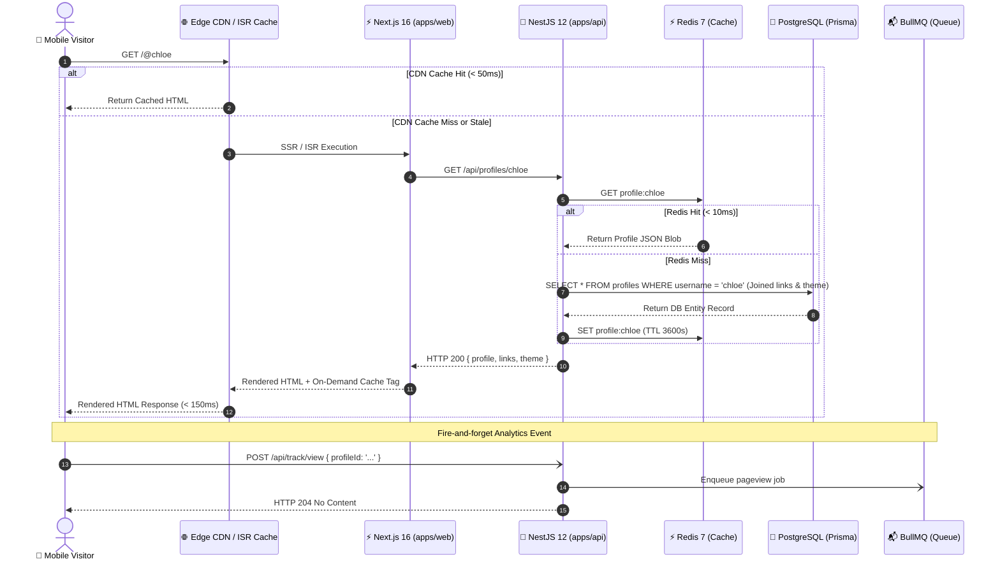
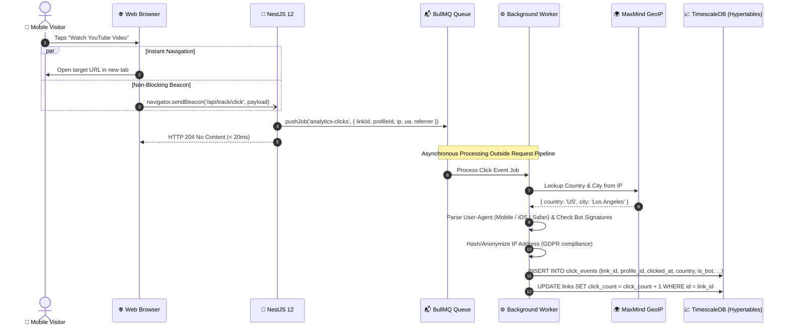
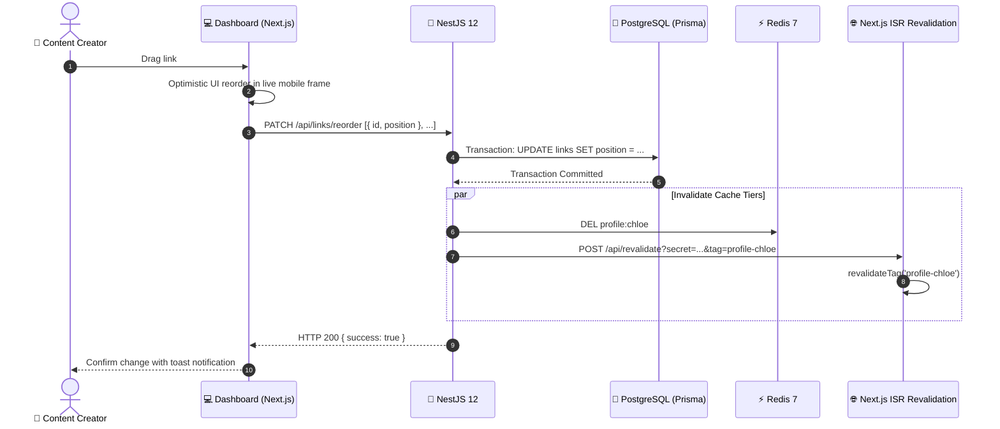
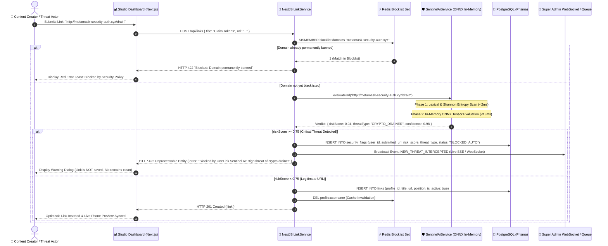
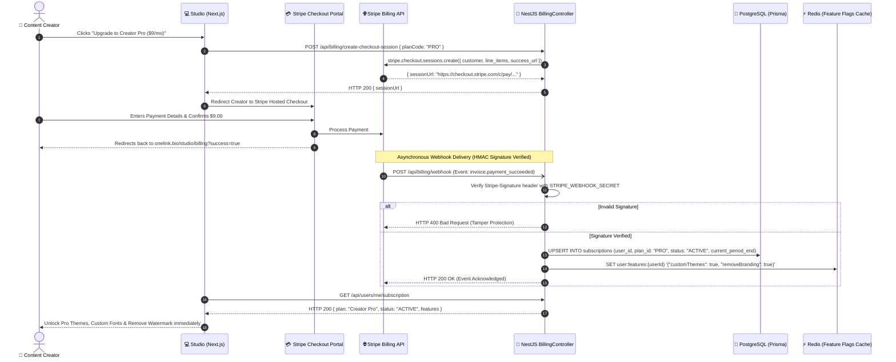

# 🔄 Sequence & Interaction Flows

> **Scope**: Critical user journeys and system communication protocols  
> **Notation**: Mermaid Sequence Diagrams  
> **Status**: Approved  

---

## 1. Flow 1: Public Profile Rendering (Hot Path)

The most latency-sensitive flow in the entire platform: a visitor taps a link in an Instagram or TikTok bio.

---

## 2. Flow 2: Asynchronous Link Click Tracking

A visitor taps a link on the profile. The destination must open instantaneously without waiting for analytics database writes.

---

## 3. Flow 3: Creator Profile Mutation & Real-Time Cache Invalidation

When a creator changes links, reorders items, or switches a theme, the public profile page must be refreshed globally.

---

## 4. Flow 4: OneLink Sentinel AI Zero-Token Threat Interception & Mitigation

When a user attempts to add a link, the in-process Sentinel AI engine inspects the URL before saving to PostgreSQL. Malicious or phishing links are blocked in <25ms with HTTP 422 and immediately routed to the Super Admin moderation queue.

---

## 5. Flow 5: SaaS Owner Subscription Provisioning & Stripe Webhook Lifecycle

When a creator upgrades to "Creator Pro" ($9/mo) or "Enterprise Studio" ($29/mo), Stripe checkout handles billing and dispatches secure webhooks to provision features atomically.

