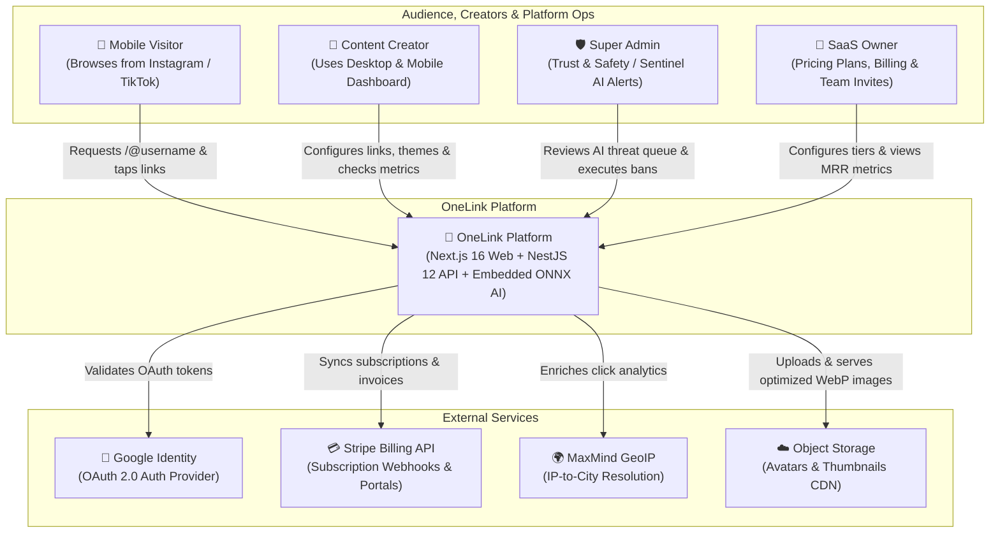
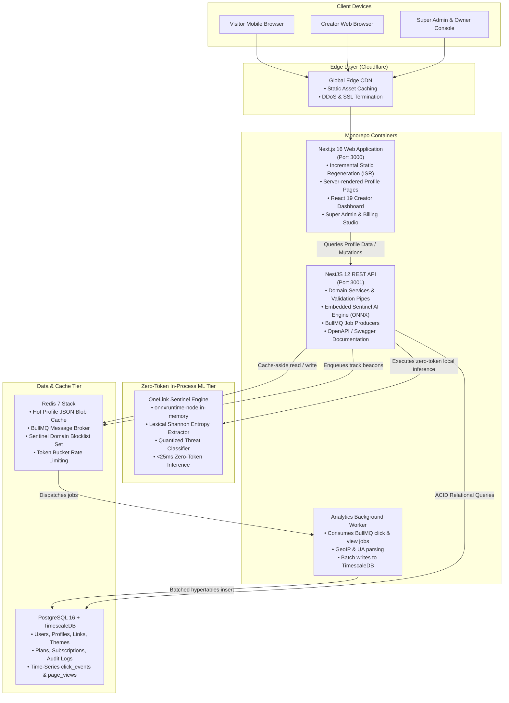
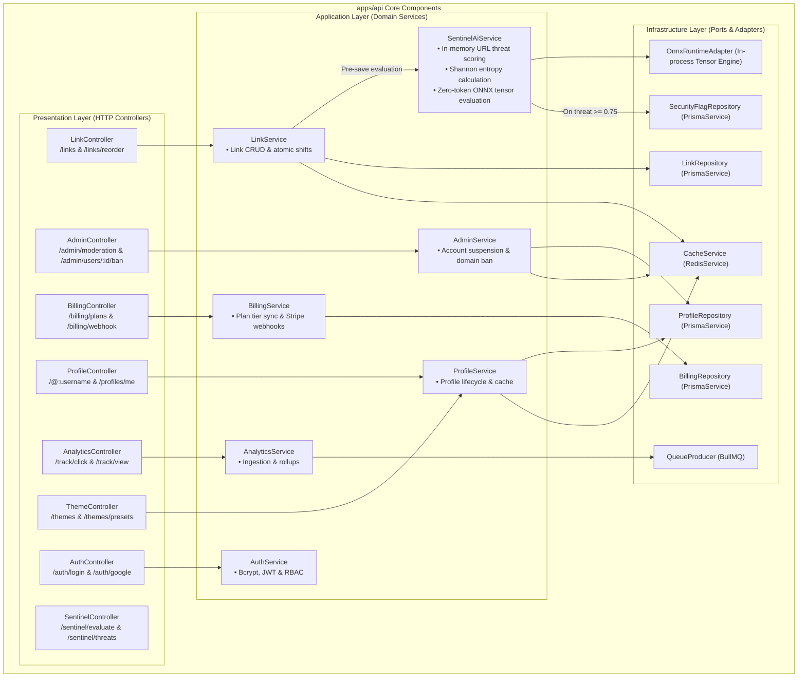
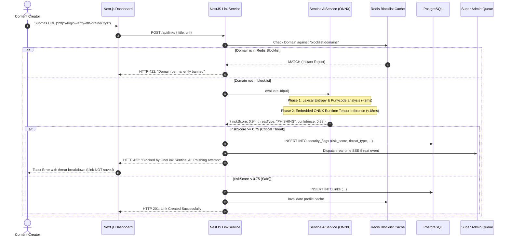

# 🏛️ System Architecture Document (SAD)

> **Architectural Style**: Clean Architecture / Ports & Adapters (Hexagonal) inside Monorepo  
> **Documentation Standard**: C4 Model (Context, Container, Component, Code)  
> **Status**: Approved  

---

## 1. C4 Model — Level 1: System Context Diagram

---

## 2. C4 Model — Level 2: Container Diagram

---

## 3. C4 Model — Level 3: Component Diagram (NestJS API Architecture)

---

## 4. Cache Topology & Fallback Architecture

To guarantee the sub-50ms SLA on public profiles:

1. **Tier 1 (CDN Edge)**: Cloudflare caches HTML responses for public profiles. Stale-while-revalidate headers ensure instantaneous paints.
2. **Tier 2 (Redis JSON Blob)**: If CDN misses, Next.js calls NestJS, which looks up `profile:${username}` in Redis. The payload contains the profile metadata, active links, and active theme in a single serialized JSON object.
3. **Tier 3 (PostgreSQL Fallback)**: If Redis misses, PostgreSQL is queried using Prisma with a joined `include: { links: true, theme: true, customTheme: true }`. The serialized result is cached back into Redis with a 1-hour TTL.
4. **Circuit Breaker**: If Redis crashes, `RedisService` enters fallback mode; requests bypass cache directly to PostgreSQL without crashing the user's request.

---

## 5. OneLink Sentinel AI Architecture: Zero-Token Embedded Security

