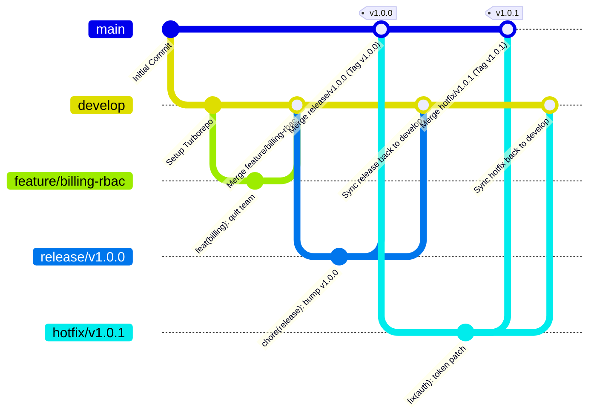

# 🌿 Git Flow Branching & Release Strategy

> Official engineering branching model for the **OneLink** platform, adhering strictly to the **Git Flow** standard with Semantic Versioning (SemVer) and Conventional Commits.

---

## 📐 Git Flow Branch Architecture



---

## 🏛️ Branch Hierarchy & Roles

| Branch Name | Origin | Merges Into | Lifetime | Description |
|---|---|---|---|---|
| **`main`** | Root | *None* | Permanent | Production-ready code only. Every commit represents an official release and must be tagged with a SemVer tag (e.g. `v1.0.0`). |
| **`develop`** | `main` | `release/*`, `hotfix/*` | Permanent | Integration branch for ongoing development. Contains all features scheduled for the next release. |
| **`feature/*`** | `develop` | `develop` | Temporary | Isolated branch for building a specific feature. Deleted after merging. |
| **`release/*`** | `develop` | `main` **and** `develop` | Temporary | Preparation for a new production release (version bump, changelog, polish). |
| **`hotfix/*`** | `main` | `main` **and** `develop` | Temporary | Emergency patch directly against production. |

---

## 🛠️ Step-by-Step Daily Workflow

### 1. Working on a New Feature
Feature branches always branch off `develop`:

```bash
# Ensure develop is up to date
git checkout develop
git pull origin develop

# Create your feature branch
git checkout -b feature/sentinel-heuristics

# ... code, commit with conventional commits ...
git commit -m "feat(sentinel): add Shannon entropy tensor calculations"

# Finish feature: merge back to develop
git checkout develop
git merge --no-ff feature/sentinel-heuristics
git branch -d feature/sentinel-heuristics
```

### 2. Creating a Release
When `develop` contains all features ready for a production release:

```bash
# Branch off develop
git checkout develop
git checkout -b release/v1.1.0

# Final adjustments: version bump in package.json, documentation
git commit -m "chore(release): prepare v1.1.0"

# Merge into main and tag
git checkout main
git merge --no-ff release/v1.1.0
git tag -a v1.1.0 -m "Release v1.1.0: Sentinel AI v2 and Theme Overhaul"

# Sync release adjustments back into develop
git checkout develop
git merge --no-ff release/v1.1.0

# Delete the release branch
git branch -d release/v1.1.0
```

### 3. Emergency Hotfix
When a critical bug is discovered in production (`main`):

```bash
# Branch directly off main
git checkout main
git checkout -b hotfix/v1.0.1

# Apply the fix
git commit -m "fix(security): prevent session token leak on logout"

# Merge fix into main and tag
git checkout main
git merge --no-ff hotfix/v1.0.1
git tag -a v1.0.1 -m "Hotfix v1.0.1: Security token patch"

# Sync fix into develop so it is never lost
git checkout develop
git merge --no-ff hotfix/v1.0.1

# Delete hotfix branch
git branch -d hotfix/v1.0.1
```

---

## 🏷️ Commit Convention (Conventional Commits)

All commits in the repository must adhere to the Conventional Commits specification:

```
<type>(<scope>): <short description>
```

| Type | When to use | Example |
|---|---|---|
| `feat` | New user-facing feature | `feat(billing): allow workspace members to quit collaboration` |
| `fix` | Bug fix | `fix(studio): prevent empty string src rendering in avatar previews` |
| `docs` | Documentation only changes | `docs: add production deployment guide in root DEPLOYMENT.md` |
| `refactor` | Code restructuring without feature or bug change | `refactor(auth): simplify JWT payload extraction` |
| `perf` | Performance optimization | `perf(cache): optimize profile Redis TTL to 600s` |
| `test` | Adding or updating unit/integration tests | `test(sentinel): add unit tests for homoglyph detection` |
| `chore` | Maintenance, dependencies, tooling | `chore(deps): update prisma to 7.10.0` |

---

## ⚙️ Standard `git flow` Tool Configuration

If using the official `git-flow` CLI tool (`git flow init`), use these defaults:

```ini
[gitflow "branch"]
    master = main
    develop = develop
[gitflow "prefix"]
    feature = feature/
    bugfix = bugfix/
    release = release/
    hotfix = hotfix/
    support = support/
    versiontag = v
```
