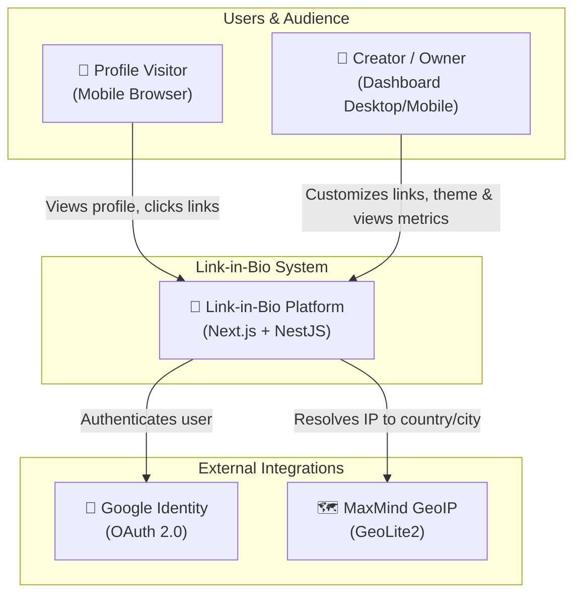
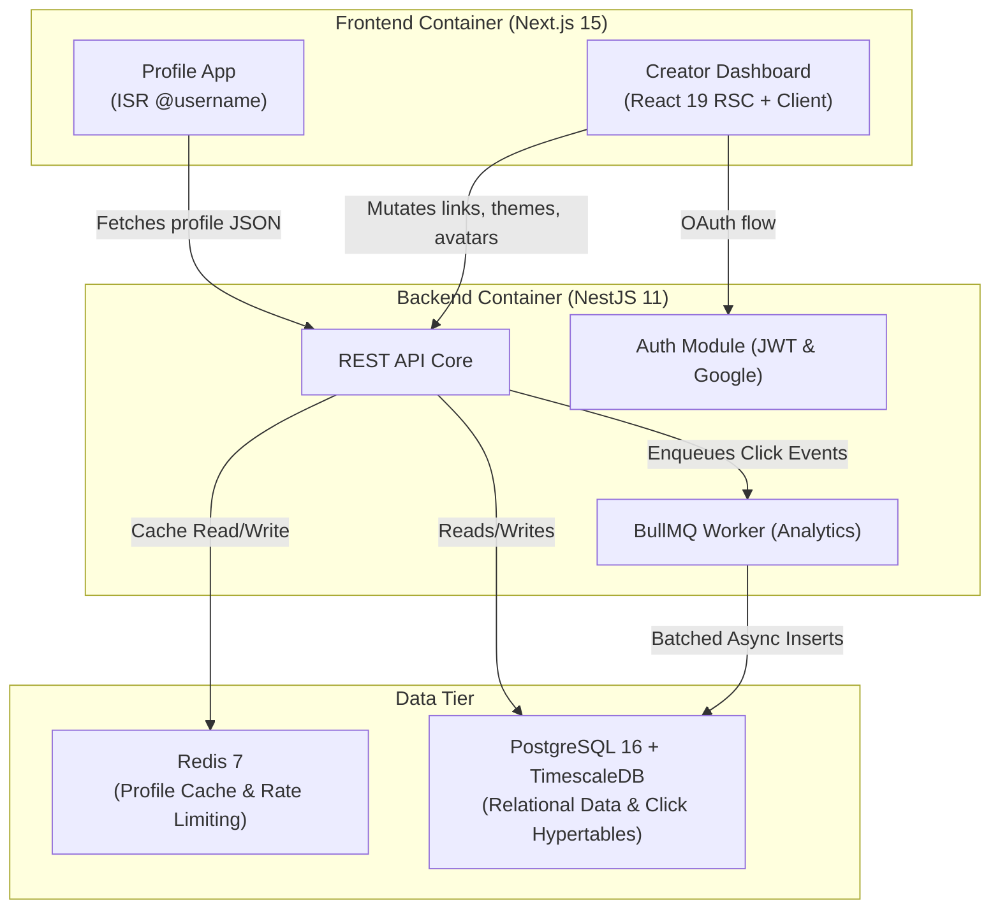
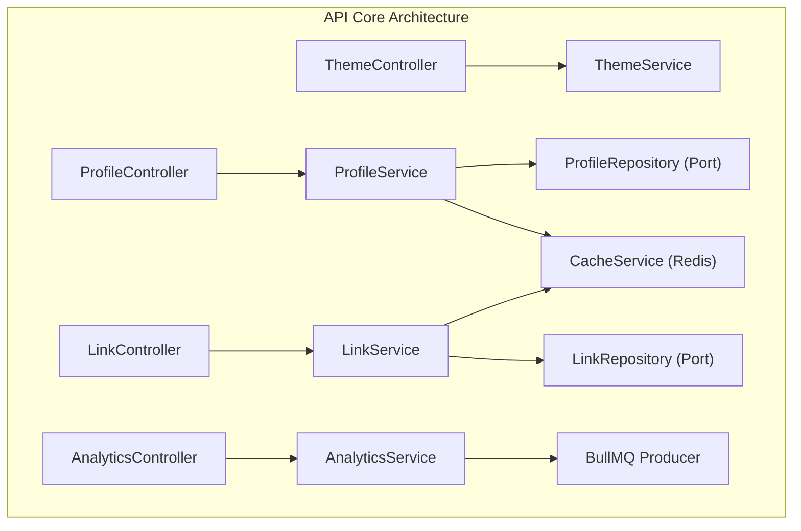
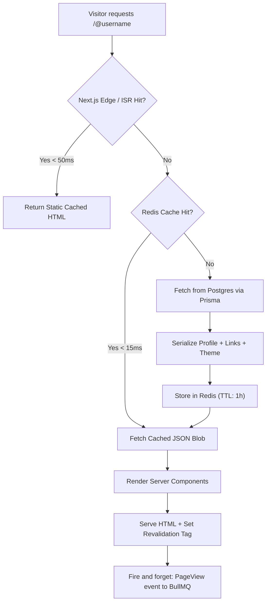
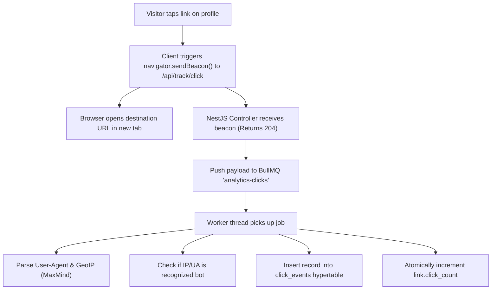

# 🔗 Link-in-Bio Platform — Master Plan

> **Project**: Scalable Link-in-Bio Platform (Linktree-style)  
> **Plan Version**: 2.1 (Updated with Modern 2026 Tech Standards)  
> **Date**: 2026-10-13  
> **Author**: crisa  
> **Purpose**: Professional portfolio + future startup foundation  

---

## 📋 Table of Contents

1. [Project Vision & Scope](#1-project-vision--scope)
2. [Requirements Analysis (SRS)](#2-requirements-analysis-srs)
3. [Tech Stack Decisions & Modern Versions](#3-tech-stack-decisions--modern-versions)
4. [System Architecture](#4-system-architecture)
5. [Database Design](#5-database-design)
6. [C4 Diagrams](#6-c4-diagrams)
7. [Flow Diagrams](#7-flow-diagrams)
8. [Design Patterns](#8-design-patterns)
9. [Testing Strategy (TDD)](#9-testing-strategy-tdd)
10. [Phased Development Plan](#10-phased-development-plan)
11. [SDLC Documentation](#11-sdlc-documentation)
12. [DevOps & Infrastructure](#12-devops--infrastructure)
13. [Metrics & Observability](#13-metrics--observability)
14. [Security](#14-security)
15. [Repository Structure](#15-repository-structure)

---

## 1. Project Vision & Scope

### 1.1 Vision

Build an **enterprise-grade Link-in-Bio platform** (Linktree-style) that allows content creators, influencers, and businesses to consolidate and showcase all their important links on a single, lightning-fast, and customizable profile page. The platform demonstrates mastery of modern distributed system design, clean architecture, high-performance web engineering, and enterprise SDLC workflows.

### 1.2 What This Product IS vs IS NOT

```
┌────────────────────────────────────────────────────────────────┐
│                     PRODUCT DEFINITION                         │
├──────────────────────────────┬─────────────────────────────────┤
│         ✅ THIS IS           │         ❌ THIS IS NOT          │
├──────────────────────────────┼─────────────────────────────────┤
│ Link-in-bio creator platform │ Generic URL shortener (bit.ly)  │
│ Profile pages with rich themes│ Plain redirect service          │
│ Built for creators & brands  │ Third-party developer API suite │
│ Instant live-preview editor  │ Static rigid page builder       │
│ Audience analytics engine    │ Bloated enterprise BI suite     │
│ Self-serve frictionless auth │ Admin-moderated closed portal   │
└──────────────────────────────┴─────────────────────────────────┘
```

### 1.3 Project Objectives

| Objective | Description |
|-----------|-------------|
| **Scalability** | Support ≥ 1M profiles and 50K+ concurrent profile views |
| **Performance** | Profile page response < 50ms (CDN/Edge hit), < 150ms (cache hit) |
| **Availability** | Target 99.9% uptime with health probes and container self-healing |
| **Engineering Rigor** | Full SDLC, TDD coverage (≥ 80%), ADRs, and automated CI/CD |
| **Portfolio Value** | Demonstrates senior-level full-stack & architecture decisions |
| **Startup Readiness** | Modular architecture prepared for future monetization (Phase 5) |

### 1.4 Target Audience & Stakeholders

- **Creators & Influencers**: Streamers, YouTubers, artists linking to their socials and content.
- **Small Businesses & Freelancers**: Digital business card for services and contact points.
- **Visitors**: Fast, mobile-first experience opening links from Instagram/TikTok bios.
- **Developer (you)**: System architect and core engineer.

> [!NOTE]
> **No Admin Portal for MVP:** Linktree and modern SaaS platforms operate self-serve. Moderation is handled via automated blocklists, DB queries, and scripts. An admin web portal is an unnecessary overhead for MVP and will only be evaluated at 100K+ user scale.

---

## 2. Requirements Analysis (SRS)

### 2.1 Functional Requirements

#### Core Features (MVP — P0)

| ID | Feature | Description | Priority |
|----|---------|-------------|----------|
| FR-001 | **Public Profile Page** | Public vanity URL at `domain.com/@username` rendering bio, avatar, social icons, and links | P0 |
| FR-002 | **Link Management** | CRUD operations: add, edit, toggle active/inactive, delete, and reorder (drag & drop) | P0 |
| FR-003 | **Link Types** | Regular links, visual headers, and dividers | P0 |
| FR-004 | **Authentication** | Email + Password (bcrypt) and **Google OAuth 2.0** | P0 |
| FR-005 | **Preset Themes** | Curated theme presets (palette, button shape, typography, background styles) | P0 |
| FR-006 | **Profile Customization** | Display name, bio text, avatar upload, and profile title | P0 |
| FR-007 | **Live Preview Dashboard** | Interactive split-screen editor with real-time mobile preview | P0 |
| FR-008 | **Mobile-First Experience** | Responsive rendering optimized for in-app mobile browsers (IG, TikTok) | P0 |

#### Enhanced Features (Post-MVP — P1)

| ID | Feature | Description | Priority |
|----|---------|-------------|----------|
| FR-009 | **Link Click Analytics** | Per-link click count, clicks over time, referrers, geo distribution, device breakdown | P1 |
| FR-010 | **Page View Analytics** | Total views vs unique visitors over time | P1 |
| FR-011 | **Custom Theme Engine** | Granular customization: custom hex colors, gradients, border radius, fonts | P1 |
| FR-012 | **Social Icons Bar** | Top or bottom row dedicated to social profile icons (IG, TikTok, X, YouTube, etc.) | P1 |
| FR-013 | **Link Thumbnails** | Upload custom icons or auto-fetch favicons for links | P1 |
| FR-014 | **SEO & Social Share (OG)** | Dynamic Open Graph image generation and meta tags per profile | P1 |

#### Advanced Features (P2 - P3)

| ID | Feature | Description | Priority |
|----|---------|-------------|----------|
| FR-015 | **Sensitive Content Warning** | Optional age or sensitive content confirmation interstitial | P2 |
| FR-016 | **Embed Blocks** | Embedded Spotify players, YouTube videos, or podcasts | P3 |
| FR-017 | **Monetization (Stripe)** | Premium tiers, custom domains, and subscription management | P3 (Last) |

---

## 3. Tech Stack Decisions & Modern Versions

### 3.1 Technology Matrix (Cutting-Edge 2026 Standards)

```
┌────────────────────────────────────────────────────────────────────────┐
│                        MODERN TECH STACK                               │
├───────────────────┬───────────────────────────────┬────────────────────┤
│ Layer             │ Technology & Version          │ Key Driver         │
├───────────────────┼───────────────────────────────┼────────────────────┤
│ Package Manager   │ pnpm 10.x                     │ Fast, disk-saving, │
│                   │                               │ strict monorepo    │
│ Monorepo Engine   │ Turborepo 2.x                 │ Remote caching,    │
│                   │                               │ task pipelines     │
│ Runtime           │ Node.js 22 LTS / 24           │ Performance, native│
│                   │                               │ fetch, modern APIs │
│ Language          │ TypeScript 5.7+               │ End-to-end typing  │
│ Frontend Web App  │ Next.js 15.2+ (App Router)    │ React 19, Server   │
│                   │ React 19                      │ Components, ISR    │
│ Styling           │ Tailwind CSS v4 + shadcn/ui   │ CSS-first engine,  │
│                   │                               │ zero-config styles │
│ Backend API       │ NestJS 11.x (with SWC compiler│ Enterprise DI,     │
│                   │ & fastify or express adapter) │ modular architecture│
│ Data Validation   │ Zod 3.24+ (shared contracts)  │ Universal schema   │
│ Relational DB     │ PostgreSQL 16 / 17            │ ACID, JSONB, rock  │
│                   │                               │ solid consistency  │
│ Time-Series DB    │ TimescaleDB 2.17+ extension   │ Zero ops overhead, │
│                   │                               │ continuous aggreg. │
│ Cache & Queues    │ Redis 7 Stack                 │ Sub-ms caching,    │
│                   │ + BullMQ                      │ rate limits, jobs  │
│ ORM               │ Prisma 6.x                    │ TypedSQL, Rust core│
│ Media Processing  │ Sharp 0.33+                   │ High-speed avatars │
│ Testing           │ Vitest / Jest + Supertest     │ Blazing unit tests │
│ E2E Testing       │ Playwright                    │ Real browser flows │
└───────────────────┴───────────────────────────────┴────────────────────┘
```

### 3.2 Why This Modern Stack?

1. **pnpm 10 + Turborepo 2**: Far cleaner and faster than npm workspaces. Strict dependency isolation avoids phantom dependencies and caching is instantaneous.
2. **Next.js 15.2+ with React 19**:
   - `app/@[username]/page.tsx` utilizes **Incremental Static Regeneration (ISR)** with on-demand cache revalidation (`revalidateTag`). Profile pages load like static files from edge caches (<50ms).
   - Live Dashboard uses React 19 Server Components + selective Client Components with `@dnd-kit/core` for buttery-smooth drag-and-drop link reordering.
3. **Tailwind CSS v4**: Uses the new lightning-fast engine (`@import "tailwindcss";`), dropping bloated `tailwind.config.js` files in favor of standard CSS variables that seamlessly power theme customization.
4. **NestJS 11 + Prisma 6**: Enterprise architecture with dependency injection, repository abstractions, typed queries, and automated migration management.
5. **PostgreSQL 16 + TimescaleDB extension + Redis 7**: Single primary database infrastructure with specialized high-volume time-series storage for clicks and page views without managing separate database clusters like ClickHouse during early stages.

---

## 4. System Architecture

### 4.1 Architecture Diagram

```
                           ┌───────────────────────────┐
                           │      Cloudflare / Edge    │
                           │  - SSL, DDoS, Global CDN  │
                           │  - Static Assets Cache    │
                           └─────────────┬─────────────┘
                                         │
                           ┌─────────────▼─────────────┐
                           │       Nginx Gateway       │
                           │  - Reverse Proxy          │
                           │  - Brotli/Gzip Compress   │
                           └─────────────┬─────────────┘
                                         │
                    ┌────────────────────┴────────────────────┐
                    │                                         │
        ┌───────────▼───────────┐                 ┌───────────▼───────────┐
        │   Next.js 15 (Web)    │                 │   Next.js 15 (Web)    │
        │ - ISR Profile Pages   │                 │ - ISR Profile Pages   │
        │ - Creator Dashboard   │                 │ - Creator Dashboard   │
        │ - NextAuth (Google)   │                 │ - NextAuth (Google)   │
        └───────────┬───────────┘                 └───────────┬───────────┘
                    │                                         │
                    └────────────────────┬────────────────────┘
                                         │ Internal HTTP / API
                    ┌────────────────────┴────────────────────┐
                    │                                         │
        ┌───────────▼───────────┐                 ┌───────────▼───────────┐
        │    NestJS 11 (API)    │                 │    NestJS 11 (API)    │
        │ - Profile & Link CRUD │                 │ - Profile & Link CRUD │
        │ - Theme Engine        │                 │ - Theme Engine        │
        │ - Rate Limiting       │                 │ - Rate Limiting       │
        └───────────┬───────────┘                 └───────────┬───────────┘
                    │                                         │
                    └────────────────────┬────────────────────┘
                                         │
              ┌──────────────────────────┼──────────────────────────┐
              │                          │                          │
    ┌─────────▼─────────┐      ┌─────────▼─────────┐      ┌─────────▼─────────┐
    │   Redis 7 Stack   │      │    BullMQ Queue   │      │  PostgreSQL 16    │
    │ - Profile JSON    │      │ - Async Clicks    │      │  + TimescaleDB    │
    │   Cache           │      │ - PageViews Job   │      │ - Users, Profiles │
    │ - Rate Limit Store│      │ - Image Resizing  │      │ - Links, Themes   │
    │ - Sessions        │      └─────────┬─────────┘      │ - click_events    │
    └───────────────────┘                │                │ - page_views      │
                               ┌─────────▼─────────┐      └───────────────────┘
                               │ Background Worker │
                               │ - GeoIP & UA Parse│
                               │ - Timescale Write │
                               └───────────────────┘
```

### 4.2 Cache & Invalidation Strategy (Hot Path)

1. **Profile Read**:
   - `GET /@username`: Edge CDN / Next.js ISR checks cache.
   - If stale or missed: Next.js queries NestJS API.
   - NestJS queries Redis (`profile:${username}`).
   - If Redis hit: returns immediately (<10ms).
   - If Redis miss: queries PostgreSQL, serializes profile + links + active theme into a single JSON object, saves to Redis (TTL 1 hour), and returns.
2. **Profile Mutation**:
   - When user edits links or appearance: NestJS updates PostgreSQL.
   - NestJS emits `ProfileUpdatedEvent`.
   - Redis cache key `profile:${username}` is deleted.
   - Next.js on-demand revalidation webhook is triggered (`revalidateTag("profile-${username}")`).
   - The public profile page is instantly fresh worldwide!

---

## 5. Database Design

### 5.1 Entity-Relationship Diagram (ERD)

```
┌──────────────────┐       ┌──────────────────┐       ┌──────────────────┐
│      users       │       │     profiles     │       │      links       │
├──────────────────┤       ├──────────────────┤       ├──────────────────┤
│ id          UUID │PK     │ id          UUID │PK     │ id          UUID │PK
│ email    VARCHAR │UQ     │ user_id     UUID │FK,UQ  │ profile_id  UUID │FK,IDX
│ password VARCHAR │       │ username VARCHAR │UQ,IDX │ title    VARCHAR │
│ name     VARCHAR │       │ title    VARCHAR │       │ url         TEXT │
│ google_id VARCHAR│UQ     │ bio         TEXT │       │ type        ENUM │
│ created_at TSTZ  │       │ avatar_url  TEXT │       │ position     INT │
│ updated_at TSTZ  │       │ theme_id    UUID │FK     │ thumbnail_url TEXT│
│ deleted_at TSTZ  │       │ is_published BOOL│       │ is_active BOOLEAN│
└────────┬─────────┘       │ seo_title VARCHAR│       │ click_count BIGINT│
         │                 │ seo_desc    TEXT │       │ created_at  TSTZ │
         │    1:1          │ og_image_url TEXT│       │ updated_at  TSTZ │
         └────────────────►│ created_at TSTZ  │       └──────────────────┘
                           │ updated_at TSTZ  │
                           └────────┬─────────┘
                                    │    1:N
                                    ├───────────────────────────┐
                                    │                           │
                                    ▼                           ▼
                           ┌──────────────────┐       ┌──────────────────┐
                           │  social_links    │       │  custom_themes   │
                           ├──────────────────┤       ├──────────────────┤
                           │ id          UUID │PK     │ id          UUID │PK
                           │ profile_id  UUID │FK,IDX │ profile_id  UUID │FK,UQ
                           │ platform    ENUM │       │ bg_type     ENUM │
                           │ url         TEXT │       │ bg_value    TEXT │
                           │ position     INT │       │ btn_style   ENUM │
                           │ is_active BOOLEAN│       │ btn_color VARCHAR│
                           │ created_at TSTZ  │       │ btn_text_color VARCHAR│
                           └──────────────────┘       │ font_family VARCHAR│
                                                      │ text_color VARCHAR│
┌──────────────────┐                                  │ btn_radius    INT │
│     themes       │                                  │ created_at  TSTZ │
├──────────────────┤                                  │ updated_at  TSTZ │
│ id          UUID │PK                                └──────────────────┘
│ name     VARCHAR │
│ bg_type     ENUM │       ┌──────────────────┐       ┌──────────────────┐
│ bg_value    TEXT │       │   page_views     │       │   click_events   │
│ btn_style   ENUM │       ├──────────────────┤       ├──────────────────┤
│ btn_color VARCHAR│       │ id        BIGINT │PK     │ id        BIGINT │PK
│ btn_text_color   │       │ profile_id  UUID │FK     │ link_id     UUID │FK
│ font_family      │       │ viewed_at  TSTZ  │Hyper  │ profile_id  UUID │FK
│ text_color       │       │ ip_address  INET │       │ clicked_at  TSTZ │Hyper
│ is_default  BOOL │       │ user_agent  TEXT │       │ ip_address  INET │
│ preview_url TEXT │       │ referrer    TEXT │       │ user_agent  TEXT │
│ created_at  TSTZ │       │ country  CHAR(2) │       │ referrer    TEXT │
└──────────────────┘       │ is_unique   BOOL │       │ country  CHAR(2) │
                           │ is_bot      BOOL │       │ is_bot      BOOL │
                           └──────────────────┘       └──────────────────┘
                            (TimescaleDB Hyper)        (TimescaleDB Hyper)
```

### 5.2 Prisma 6 Schema Specification

```prisma
// packages/prisma/schema.prisma

datasource db {
  provider   = "postgresql"
  url        = env("DATABASE_URL")
  extensions = [timescaledb]
}

generator client {
  provider        = "prisma-client-js"
  previewFeatures = ["postgresqlExtensions"]
}

enum LinkType {
  LINK
  HEADER
  DIVIDER
}

enum BgType {
  SOLID
  GRADIENT
  IMAGE
}

enum BtnStyle {
  FILLED
  OUTLINE
  SHADOW
  ROUNDED
}

enum SocialPlatform {
  INSTAGRAM
  TIKTOK
  YOUTUBE
  TWITTER
  FACEBOOK
  LINKEDIN
  GITHUB
  TWITCH
  DISCORD
  SPOTIFY
  APPLEMUSIC
  WEBSITE
  EMAIL
}

model User {
  id           String    @id @default(uuid()) @db.Uuid
  email        String    @unique
  passwordHash String?   @map("password_hash")
  name         String?
  googleId     String?   @unique @map("google_id")
  createdAt    DateTime  @default(now()) @map("created_at")
  updatedAt    DateTime  @updatedAt @map("updated_at")
  deletedAt    DateTime? @map("deleted_at")

  profile      Profile?

  @@map("users")
}

model Profile {
  id           String    @id @default(uuid()) @db.Uuid
  userId       String    @unique @map("user_id") @db.Uuid
  username     String    @unique @db.VarChar(30)
  title        String?   @db.VarChar(100)
  bio          String?   @db.VarChar(500)
  avatarUrl    String?   @map("avatar_url")
  themeId      String?   @map("theme_id") @db.Uuid
  isPublished  Boolean   @default(false) @map("is_published")
  seoTitle     String?   @map("seo_title") @db.VarChar(60)
  seoDesc      String?   @map("seo_description") @db.VarChar(160)
  ogImageUrl   String?   @map("og_image_url")
  createdAt    DateTime  @default(now()) @map("created_at")
  updatedAt    DateTime  @updatedAt @map("updated_at")

  user         User         @relation(fields: [userId], references: [id], onDelete: Cascade)
  theme        Theme?       @relation(fields: [themeId], references: [id])
  links        Link[]
  socialLinks  SocialLink[]
  customTheme  CustomTheme?

  @@index([username])
  @@map("profiles")
}

model Link {
  id            String    @id @default(uuid()) @db.Uuid
  profileId     String    @map("profile_id") @db.Uuid
  title         String    @db.VarChar(200)
  url           String?
  type          LinkType  @default(LINK)
  position      Int       @default(0)
  thumbnailUrl  String?   @map("thumbnail_url")
  isActive      Boolean   @default(true) @map("is_active")
  clickCount    BigInt    @default(0) @map("click_count")
  createdAt     DateTime  @default(now()) @map("created_at")
  updatedAt     DateTime  @updatedAt @map("updated_at")

  profile       Profile   @relation(fields: [profileId], references: [id], onDelete: Cascade)

  @@index([profileId, position])
  @@map("links")
}

model Theme {
  id            String   @id @default(uuid()) @db.Uuid
  name          String   @db.VarChar(50)
  bgType        BgType   @default(SOLID) @map("bg_type")
  bgValue       String   @map("bg_value")
  btnStyle      BtnStyle @default(FILLED) @map("btn_style")
  btnColor      String   @map("btn_color")
  btnTextColor  String   @map("btn_text_color")
  fontFamily    String   @default("Inter") @map("font_family")
  textColor     String   @default("#000000") @map("text_color")
  isDefault     Boolean  @default(false) @map("is_default")
  previewUrl    String?  @map("preview_url")
  createdAt     DateTime @default(now()) @map("created_at")

  profiles      Profile[]

  @@map("themes")
}

model CustomTheme {
  id            String   @id @default(uuid()) @db.Uuid
  profileId     String   @unique @map("profile_id") @db.Uuid
  bgType        BgType   @default(SOLID) @map("bg_type")
  bgValue       String   @map("bg_value")
  btnStyle      BtnStyle @default(FILLED) @map("btn_style")
  btnColor      String   @map("btn_color")
  btnTextColor  String   @map("btn_text_color")
  fontFamily    String   @default("Inter") @map("font_family")
  textColor     String   @default("#000000") @map("text_color")
  btnRadius     Int      @default(8) @map("btn_radius")
  createdAt     DateTime @default(now()) @map("created_at")
  updatedAt     DateTime @updatedAt @map("updated_at")

  profile       Profile  @relation(fields: [profileId], references: [id], onDelete: Cascade)

  @@map("custom_themes")
}

model SocialLink {
  id          String         @id @default(uuid()) @db.Uuid
  profileId   String         @map("profile_id") @db.Uuid
  platform    SocialPlatform
  url         String
  position    Int            @default(0)
  isActive    Boolean        @default(true) @map("is_active")
  createdAt   DateTime       @default(now()) @map("created_at")

  profile     Profile        @relation(fields: [profileId], references: [id], onDelete: Cascade)

  @@index([profileId, position])
  @@map("social_links")
}
```

---

## 6. C4 Diagrams

### 6.1 Level 1 — Context Diagram



### 6.2 Level 2 — Container Diagram



### 6.3 Level 3 — Component Diagram (NestJS API)



---

## 7. Flow Diagrams

### 7.1 Profile Page Request Flow



### 7.2 Link Click Tracking Flow



---

## 8. Design Patterns

1. **Repository Pattern (Ports & Adapters)**: Business logic in `ProfileService` does not directly depend on Prisma queries. An `IProfileRepository` interface allows unit testing with in-memory test doubles without running a DB.
2. **Strategy Pattern (Theme Rendering)**: Different theme types (`SolidThemeStrategy`, `GradientThemeStrategy`, `ImageThemeStrategy`) generate the corresponding CSS variables and layout styles cleanly.
3. **Observer / Event-Driven Pattern**: Profile mutations trigger an internal `ProfileChangedEvent`. Multiple listeners react asynchronously:
   - Invalidate Redis cache.
   - Send revalidation webhook to Next.js (`revalidateTag`).
   - Audit logging.
4. **Adapter Pattern (File Storage)**: An `IStorageService` interface wraps file operations. In development, files are written to local disk. For cloud production, an S3/R2 adapter can be slotted in with zero changes to domain services.
5. **Circuit Breaker & Fallback**: If Redis is unreachable, NestJS automatically falls back directly to PostgreSQL without crashing the request pipeline.

---

## 9. Testing Strategy (TDD)

### 9.1 Testing Pyramid & Coverage Thresholds

```
                      ┌───────────────┐
                      │  Playwright   │  ~10 Critical E2E Journeys
                      │   (Browser)   │  (Signup, Edit, Live Preview, Click)
                      ├───────────────┤
                      │   Supertest   │  ~50 API Integration Tests
                      │ (Dockerized DB│  (Controllers, Guards, Cache-aside)
                      ├───────────────┤
                      │  Vitest/Jest  │  ~200+ Fast Unit Tests
                      │    (Mocks)    │  (Services, Domain Entities, Utils)
                      └───────────────┘

  Coverage Gates: Minimum 80% line coverage and 90% core domain branch coverage.
```

### 9.2 Strict Red-Green-Refactor Flow

1. **Red**: Write a test verifying that creating duplicate usernames returns a `409 Conflict` domain exception.
2. **Green**: Write the minimal implementation in `ProfileService` and Prisma repository.
3. **Refactor**: Clean up DTO validation, extract sanitization helpers, verify all tests pass.

---

## 10. Phased Development Plan

### 10.1 Roadmap Overview

```
┌────────────────────────────────────────────────────────────────────────┐
│                      16-WEEK ROADMAP SCHEDULE                          │
├─────────┬────────────────────────────┬─────────────────────────────────┤
│ Phase   │ Focus                      │ Target Outcomes                 │
├─────────┼────────────────────────────┼─────────────────────────────────┤
│ Phase 0 │ Foundation & Scaffold      │ pnpm 10 monorepo, Turborepo 2,  │
│ (W1-2)  │                            │ Docker Compose, CI/CD, Prisma 6 │
├─────────┼────────────────────────────┼─────────────────────────────────┤
│ Phase 1 │ Core API & Data Modeling   │ Profiles, links, themes, Redis  │
│ (W3-5)  │                            │ cache-aside, Swagger/OpenAPI    │
├─────────┼────────────────────────────┼─────────────────────────────────┤
│ Phase 2 │ Auth & Media Engine        │ Google OAuth 2.0, JWT tokens,   │
│ (W5-7)  │                            │ Sharp avatar upload pipeline    │
├─────────┼────────────────────────────┼─────────────────────────────────┤
│ Phase 3 │ High-Throughput Analytics  │ TimescaleDB hypertables, BullMQ │
│ (W7-9)  │                            │ workers, GeoIP, continuous agg. │
├─────────┼────────────────────────────┼─────────────────────────────────┤
│ Phase 4 │ Next.js 15 Frontend        │ Responsive dashboard, dnd-kit,  │
│ (W9-13) │                            │ ISR public profiles, charts     │
├─────────┼────────────────────────────┼─────────────────────────────────┤
│ Phase 5 │ Polish & Monetization Ready│ E2E tests, k6 benchmarks,       │
│ (W13-15)│                            │ optional Stripe integration     │
├─────────┼────────────────────────────┼─────────────────────────────────┤
│ Phase 6 │ Observability & Production │ Prometheus/Grafana, Nginx SSL,  │
│ (W15-16)│                            │ documentation site, portfolio   │
└─────────┴────────────────────────────┴─────────────────────────────────┘
```

### 10.2 Detailed Phase Tasks & Deliverables

#### Phase 0 — Foundation & Infrastructure (Weeks 1-2)

| Task | Detail | Deliverables |
|------|--------|--------------|
| **0.1** | Initialize monorepo with `pnpm 10` workspaces + `Turborepo 2` | `pnpm-workspace.yaml`, `turbo.json`, root `package.json` |
| **0.2** | Configure shared tooling packages (`typescript-config`, `eslint-config`) | Clean compiler & lint rules across all workspaces |
| **0.3** | Setup Prisma 6 package (`packages/prisma`) with initial PostgreSQL schema | `schema.prisma`, initial migration scripts, seed file |
| **0.4** | Configure Docker Compose for local development (TimescaleDB PG16 + Redis 7 + Mailhog) | `infrastructure/docker/docker-compose.yml` |
| **0.5** | Configure GitHub Actions CI workflow (lint, typecheck, test, build) | `.github/workflows/ci.yml` |
| **0.6** | Establish Git conventions: Conventional Commits, Husky pre-commit, commitlint | `.husky/`, `commitlint.config.js` |
| **0.7** | Initialize project documentation structure in `/docs` | `docs/master-plan.md`, `README.md`, `CONTRIBUTING.md` |

#### Phase 1 — Core Backend API: Profiles & Links (Weeks 3-5)

| Task | Detail | Deliverables |
|------|--------|--------------|
| **1.1** | Scaffold NestJS 11 application with SWC compiler | `apps/api` base setup, modular folder structure |
| **1.2** | Setup PrismaService & RedisService with health-checks & connection pooling | Database & Cache infrastructure modules |
| **1.3** | Profile Module (TDD): Create, read, update profile, username reservation & blocklist | `ProfileController`, `ProfileService`, `ProfileRepository` |
| **1.4** | Link Module (TDD): CRUD operations, active/inactive toggle, position management | `LinkController`, `LinkService`, drag-reorder endpoints |
| **1.5** | Social Links Module: CRUD for social media icons and ordering | `SocialLinkService`, validation by platform |
| **1.6** | Theme Presets Module: Query curated themes and custom CSS variables | `ThemeService`, seed data with 10+ modern themes |
| **1.7** | Public Profile Endpoint (`GET /@:username`): Redis Cache-Aside implementation | Sub-15ms cached profile resolver with cache invalidation |
| **1.8** | Global filters, interceptors, and Zod/class-validator validation pipes | Uniform error responses, request logging, input validation |
| **1.9** | OpenAPI / Swagger 3.0 auto-generation | Interactive API documentation at `/api/docs` |
| **1.10**| API Integration test suite using Supertest & Testcontainers | Verified test coverage for all Phase 1 endpoints (≥80%) |

#### Phase 2 — Authentication & Media Pipeline (Weeks 5-7)

| Task | Detail | Deliverables |
|------|--------|--------------|
| **2.1** | Auth Module: Password hashing (bcrypt), JWT access tokens & HttpOnly refresh tokens | Secure token rotation mechanism |
| **2.2** | Google OAuth 2.0 integration via Passport Google Strategy | Google login/signup callback handler, user profile sync |
| **2.3** | User Settings Module: Account profile, password change, email verification | User management endpoints |
| **2.4** | Avatar Upload Pipeline: Multipart upload with file-type & size validation | Secure upload controller |
| **2.5** | High-speed image processing with `Sharp`: WebP conversion, auto-crop & multi-resolution resizing | Optimized avatar assets pipeline |
| **2.6** | Storage Abstraction (Adapter Pattern): `IStorageService` with local disk & S3-compatible interfaces | Swap-ready storage adapters |

#### Phase 3 — High-Throughput Analytics Engine (Weeks 7-9)

| Task | Detail | Deliverables |
|------|--------|--------------|
| **3.1** | Lightweight click beacon endpoint (`POST /api/track/click`, returns 204 immediately) | Fire-and-forget ingestion endpoint |
| **3.2** | Page view tracking endpoint (`POST /api/track/view`) | Client-side tracking beacon integration |
| **3.3** | BullMQ queue producer & consumer background worker setup | Distributed job queue with Redis |
| **3.4** | GeoIP resolution (MaxMind GeoLite2) & User-Agent parsing (device, browser, OS) | Enriched click/view event metadata |
| **3.5** | Bot detection engine: Filter out crawlers, preview scrapers, and spam traffic | Clean analytics data pipeline |
| **3.6** | TimescaleDB Hypertables & Continuous Aggregates setup | Daily/hourly materialized views for instant dashboard queries |
| **3.7** | Analytics Query Service: Aggregated stats by time, referrer, geo, and device | High-speed analytical reporting API |

#### Phase 4 — Frontend Web Application (Next.js 15.2 + React 19) (Weeks 9-13)

| Task | Detail | Deliverables |
|------|--------|--------------|
| **4.1** | Scaffold Next.js 15.2 App Router with React 19 and Tailwind CSS v4 | `apps/web` base setup, modern layout architecture |
| **4.2** | Setup UI component library with `shadcn/ui` tailored for Tailwind v4 | Buttons, modals, dropdowns, inputs, toasts, tabs |
| **4.3** | Authentication views: Login, Register, Google OAuth button, forgot password | Responsive auth pages with client-side Zod validation |
| **4.4** | Creator Dashboard Shell: Sidebar navigation, profile header, responsive mobile drawer | High-performance dashboard layout |
| **4.5** | Links Editor with Drag-and-Drop: `@dnd-kit/core` link reordering with optimistic UI updates | Smooth drag-and-drop link manager |
| **4.6** | Live Mobile Preview: Split-screen desktop editor with synchronized real-time phone mockup | Real-time preview of profile changes |
| **4.7** | Theme Selector & Customizer: Real-time CSS variable manipulation (colors, radius, fonts) | Visual theme customizer |
| **4.8** | Public Profile Page (`app/@[username]/page.tsx`): Server-rendered with ISR & dynamic theming | Ultra-fast public profile rendering (<50ms) |
| **4.9** | Dynamic Open Graph (OG) image generation (`@vercel/og`) for social sharing | Automated rich preview cards for Twitter/iMessage |
| **4.10**| Analytics Dashboard: Interactive charts (Recharts) for clicks, views, geo map, and referrers | Visual insights dashboard |

#### Phase 5 — System Hardening, E2E Testing & Monetization (Weeks 13-15)

| Task | Detail | Deliverables |
|------|--------|--------------|
| **5.1** | End-to-End test suite with Playwright: Full user journey testing | Automated test flows: Signup → Add Links → View Profile |
| **5.2** | Performance benchmarking with `k6`: Profile page load & click tracking stress test | Verified targets (10K RPS, p99 < 50ms) |
| **5.3** | Accessibility audit with `axe-core`: Ensure WCAG 2.1 AA compliance on public pages | Full a11y score & compliance report |
| **5.4** | Security hardening: CSP headers, Helmet, rate limiting verification, CORS locks | Comprehensive security checklist verified |
| **5.5** | Monetization Foundation (Stripe Integration — Optional/Phase 5): Pro tier & billing portal | Webhook handler, subscription lifecycle management |

#### Phase 6 — Production Deployment & Observability (Weeks 15-16)

| Task | Detail | Deliverables |
|------|--------|--------------|
| **6.1** | Production multi-stage Dockerfiles with unprivileged users & minimal images | Production-grade container builds |
| **6.2** | Nginx reverse proxy configuration with HTTP/2, Brotli compression, and SSL | Secure gateway configuration |
| **6.3** | Health check endpoints (`/health/live`, `/health/ready`) with DB & Redis probes | Liveness/readiness probes for zero-downtime deploys |
| **6.4** | Prometheus metrics scraping & Grafana dashboard integration | Real-time monitoring of RPS, latency, and system health |
| **6.5** | Structured logging pipeline with Pino & request correlation IDs | Traceable, searchable application logs |
| **6.6** | Finalized documentation, architecture diagrams, and portfolio README showcase | Outstanding open-source portfolio presentation |

---

## 11. SDLC Documentation

All documents are maintained in GitHub-flavored Markdown in the project's `/docs` directory:

```
docs/
├── master-plan.md              # Living master plan (this document)
├── prd.md                      # Product Requirements Document
├── srs.md                      # Software Requirements Specification
├── architecture.md             # System Architecture Document (SAD)
├── api-spec.yaml               # OpenAPI 3.0 / Swagger definition
├── test-plan.md                # TDD and QA matrix
├── runbook.md                  # Deployment, backup, and incident guide
├── security.md                 # Security policies & sanitization
├── performance-benchmarks.md   # k6 stress testing logs
└── adr/                        # Architecture Decision Records
    ├── 001-monorepo-pnpm-turbo.md
    ├── 002-backend-nestjs.md
    ├── 003-frontend-nextjs-isr.md
    ├── 004-database-postgres-timescale.md
    ├── 005-caching-redis-profile-blob.md
    ├── 006-auth-jwt-google-oauth.md
    ├── 007-styling-tailwind-v4.md
    └── 008-analytics-bullmq-worker.md
```

---

## 12. DevOps & Infrastructure

### 12.1 Local Development Docker Compose

```yaml
# infrastructure/docker/docker-compose.yml
services:
  postgres:
    image: timescale/timescaledb:latest-pg16
    ports: ["5432:5432"]
    environment:
      POSTGRES_USER: dev_user
      POSTGRES_PASSWORD: dev_password
      POSTGRES_DB: linktree_dev
    volumes:
      - pgdata:/var/lib/postgresql/data

  redis:
    image: redis:7-alpine
    ports: ["6379:6379"]
    volumes:
      - redisdata:/data

  mailhog:
    image: mailhog/mailhog
    ports: ["8025:8025", "1025:1025"]

volumes:
  pgdata:
  redisdata:
```

### 12.2 GitHub Actions CI Pipeline

On every PR and push:
1. `pnpm install --frozen-lockfile`
2. `pnpm turbo run lint`
3. `pnpm turbo run typecheck`
4. Spin up PostgreSQL + Redis service containers
5. Run Prisma migrations: `pnpm turbo run db:migrate`
6. Execute Vitest/Jest unit & integration tests
7. Run build: `pnpm turbo run build`

---

## 13. Metrics & Observability

- **Golden Signals**:
  - Request Rate (RPS per route)
  - Error Rate (4xx vs 5xx HTTP codes)
  - Latency (p50, p95, p99 on `/@[username]`)
  - Saturation (CPU, Memory, Redis memory usage)
- **Structured JSON Logging (Pino)**:
  - Every HTTP request tagged with a unique `X-Request-ID`.
  - Sensitive parameters (passwords, tokens) strictly redacted.

---

## 14. Security

- **Strict Username Sanitization**: Reserved keywords (`admin`, `api`, `dashboard`, `settings`, `login`, `register`, `terms`, `privacy`) blocked.
- **XSS Mitigation**: Strict sanitization of user bio and link titles. Next.js automatic string escaping + CSP headers.
- **SSRF Prevention**: Links are validated against internal IP ranges (`127.0.0.1`, `10.0.0.0/8`, `192.168.0.0/16`).
- **Rate Limiting**: Redis Token Bucket algorithm protects `/api/auth/*` and tracking endpoints.

---

## 15. Repository Structure

```
url-shortener/
├── .github/
│   ├── workflows/
│   │   ├── ci.yml
│   │   └── cd.yml
│   └── pull_request_template.md
│
├── apps/
│   ├── api/                          # NestJS 11 Backend
│   │   ├── src/
│   │   │   ├── main.ts
│   │   │   ├── app.module.ts
│   │   │   ├── common/
│   │   │   │   ├── decorators/
│   │   │   │   ├── filters/
│   │   │   │   ├── guards/
│   │   │   │   └── pipes/
│   │   │   ├── modules/
│   │   │   │   ├── auth/             # JWT & Google OAuth
│   │   │   │   ├── profile/          # Profile CRUD & public fetch
│   │   │   │   ├── link/             # Link management & reordering
│   │   │   │   ├── theme/            # Theme presets & custom CSS
│   │   │   │   ├── analytics/        # BullMQ producers & Timescale
│   │   │   │   └── media/            # Sharp image processing
│   │   │   └── infrastructure/       # DB, Redis, BullMQ, Storage
│   │   ├── test/
│   │   ├── tsconfig.json
│   │   └── package.json
│   │
│   └── web/                          # Next.js 15.2 (React 19) Frontend
│       ├── src/
│       │   ├── app/
│       │   │   ├── (auth)/login/
│       │   │   ├── (auth)/register/
│       │   │   ├── (dashboard)/
│       │   │   │   ├── links/        # Drag & drop editor
│       │   │   │   ├── appearance/   # Theme builder
│       │   │   │   └── analytics/    # Recharts metrics
│       │   │   ├── @[username]/      # ISR Public profile page
│       │   │   ├── layout.tsx
│       │   │   └── globals.css       # Tailwind v4 import
│       │   ├── components/
│       │   │   ├── ui/               # shadcn/ui components
│       │   │   ├── editor/           # Live preview & dnd components
│       │   │   └── profile/          # Profile widgets
│       │   └── lib/
│       ├── tsconfig.json
│       └── package.json
│
├── packages/
│   ├── shared/                       # Shared DTOs, Zod contracts, constants
│   │   ├── src/
│   │   └── package.json
│   ├── prisma/                       # Prisma 6 client & migrations
│   │   ├── schema.prisma
│   │   ├── seed.ts
│   │   └── package.json
│   ├── typescript-config/            # Shared tsconfig bases
│   │   └── base.json
│   └── eslint-config/                # Shared ESLint & Prettier
│       └── package.json
│
├── infrastructure/
│   ├── docker/
│   │   └── docker-compose.yml
│   └── nginx/
│       └── nginx.conf
│
├── docs/                             # Complete SDLC Markdown Documentation
│   ├── master-plan.md                # This master plan
│   ├── prd.md
│   ├── srs.md
│   ├── architecture.md
│   ├── api-spec.yaml
│   └── adr/
│
├── pnpm-workspace.yaml
├── turbo.json
├── package.json
├── .gitignore
├── .editorconfig
└── README.md
```
