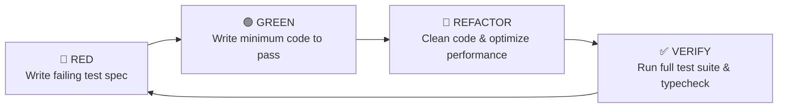

# 🧪 Quality Assurance & Test Strategy Plan

> **Scope**: Unit, Integration, End-to-End (E2E), and Performance Testing across Monorepo  
> **Status**: Approved  
> **Target Coverage**: ≥ 80% line and branch coverage on business logic  

---

## 1. Testing Pyramid & Tooling Matrix

```
                ▲
               / \
              /E2E\             Playwright (User Journeys)
             /-----\
            / Integ \           Supertest + Testcontainers (API & DB)
           /---------\
          /   Unit    \         Jest 29 + React Testing Library (Domain & Components)
         /-------------\
```

| Layer | Tools | Target Area | Execution Trigger |
|---|---|---|---|
| **Static Analysis** | ESLint 9, TypeScript 6 strict | Type safety, syntax, import integrity | Pre-commit & CI |
| **Unit Testing** | Jest 29, SWC, `@testing-library/react` | Domain services, Zod schemas, UI components | Every local save / commit |
| **Integration** | Supertest, Docker TimescaleDB & Redis | Controllers, Repositories, Database constraints | Pre-push & CI pull request |
| **End-to-End (E2E)** | Playwright (Chromium, Firefox, WebKit) | Onboarding, link reordering, live preview | Nightly / Release candidate |
| **Load & Stress** | k6 | Hot path profile read (`/@username`) and click beacon ingestion | Pre-release benchmark |

---

## 2. Test Suites by Module

### 2.1 Profile Module (`apps/api/src/profile`)
- **Unit**:
  - `ProfileService.findByUsername`: Cache hit (returns Redis blob without calling Prisma).
  - `ProfileService.findByUsername`: Cache miss (queries Prisma, writes to Redis with 5-minute TTL).
  - `ProfileService.createProfile`: Validates against `RESERVED_USERNAMES`. Throws `ConflictException` on duplicate.
- **Integration**:
  - `GET /api/profiles/:username`: Returns 200 with sanitized profile data when published.
  - `GET /api/profiles/:username`: Returns 404 when `isPublished: false` and caller is unauthenticated.

### 2.2 Link Module (`apps/api/src/link`)
- **Unit**:
  - `LinkService.reorder`: Validates input array consistency. Calculates atomic batch update operations.
  - `LinkService.create`: Sanitizes destination URL, sets correct tail position.
- **Integration**:
  - `POST /api/links`: Rejects invalid URL schemas (`javascript:alert(1)`, `ftp://`).
  - `PATCH /api/links/reorder`: Executes atomic transaction; invalidates profile cache key.

### 2.3 Analytics Ingestion Module (`apps/api/src/analytics`)
- **Unit**:
  - `AnalyticsService.trackClick`: Validates click beacon payload via `TrackClickSchema`.
  - Enqueues job to BullMQ queue without blocking HTTP response.
- **Integration**:
  - `POST /api/track/click`: Responds HTTP 204 No Content in < 25ms.
  - Background worker consumes BullMQ job and writes to TimescaleDB hypertable chunk.

---

## 3. Test-Driven Development (TDD) Workflow

For all subsequent domain modules, implementation strictly adheres to the **Red-Green-Refactor** cycle:



1. **Red**: Write a unit/integration test in `*.spec.ts` asserting expected domain behavior. Run `pnpm test` and verify failure.
2. **Green**: Implement the minimal code in service/controller/repository to satisfy the test.
3. **Refactor**: Clean up abstractions, verify edge cases, format code, and ensure zero lint or type errors.
