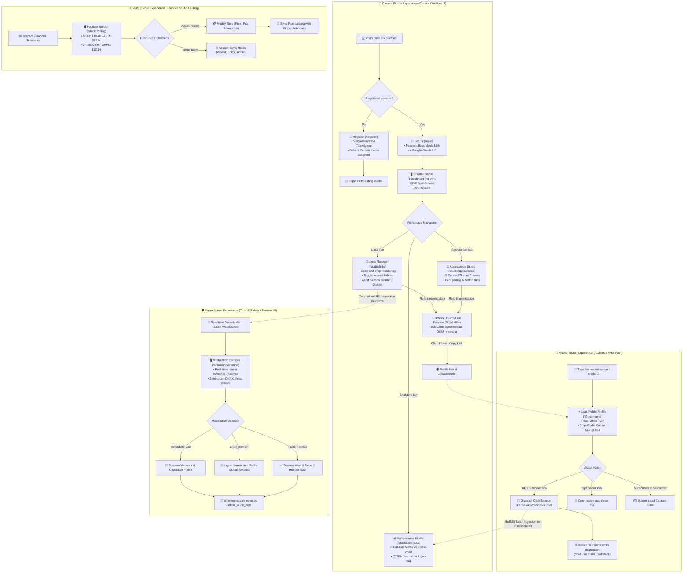

# 🗺️ Information Architecture, User Flows & Screen Sitemap

> **SDLC Phase**: User Experience (UI/UX) Analysis & System Design  
> **Unified Google Stitch Project**: `OneLink Platform` ([ID: 14141085438200447026](https://stitch.withgoogle.com))  
> **Status**: Approved & Synchronized across 6-Screen Unified Canvas  

---

## 1. End-to-End User Flow & State Transitions Diagram

This diagram models the end-to-end operational flows and transition states across all four platform personas: **Mobile Visitor** (Audience), **Creator** (Studio User), **Super Admin** (Trust & Safety), and **SaaS Owner** (Founder & Billing):



---

## 2. Complete Route Architecture & 6-Screen Sitemap

The application enforces strict separation of concerns across public, creator, security, and founder scopes:

```
/ (Commercial Landing Page & Hero Preview)
├── /register (Account Creation & Username Slug Reservation)
├── /login (JWT Session & Google OAuth 2.0)
│
├── /@:username (Screen 1: Hot Path — Mobile Visitor Public Profile)
│   ├── Viewport: Mobile-First (390×844px)
│   ├── Edge Cache-Tag: "profile-[username]" (On-demand revalidation)
│   └── Ingestion Beacon: POST /api/track/click (204 No Content)
│
├── /studio (Creator Studio — Protected by JWT Session Guard)
│   ├── Viewport: Desktop 1440p Split-Screen (60% Workbench | 40% Live Preview)
│   ├── /studio/links (Screen 2: Link CRUD, Drag & Drop Reordering, Live Preview)
│   ├── /studio/appearance (Screen 3: 5 Curated Theme Presets, Fonts, Button Shapes)
│   ├── /studio/analytics (Screen 4: TimescaleDB Telemetry, CTR%, Geo Heatmap)
│   └── /studio/billing (Screen 6: SaaS Owner Billing, Tier Matrix, Team RBAC)
│
└── /admin (Trust & Safety — Protected by RBAC: Role == SUPER_ADMIN)
    └── /admin/moderation (Screen 5: OneLink Sentinel AI Threat Stream & Account Ban)
```

---

## 3. Interface 5-State Matrix per Screen

To ensure an enterprise-grade user experience prior to code implementation, each screen defines 5 explicit states: **Loading**, **Empty**, **Populated (Success)**, **Error**, and **Optimistic Interaction**:

| Screen | Loading State | Empty State | Populated State (Success) | Error State | Optimistic Interaction |
|---|---|---|---|---|---|
| **1. Public Profile (`/@username`)** | Shimmer skeleton cards matching pill button geometry | Minimal greeting: *"Alex has not published any links yet"* | Avatar, bio, verified badge, social pills, and themed link cards | HTTP 404: *"Profile not found or currently unpublished"* | Outbound navigation triggers instant 302 redirect while Beacon dispatches asynchronously in background |
| **2. Studio: Links (`/studio/links`)** | Card skeletons with drag-handle placeholders | Empty illustration: *"Add your first link to get started"* | Reorderable link cards with click badges, toggles, and edit drawers | Red banner: *"Failed to save reorder. Restoring previous position"* | Drag-and-drop applies instantly to DOM and live iPhone preview; rolls back on network error |
| **3. Studio: Appearance (`/studio/appearance`)** | Grid shimmer for 5 theme preview cards | N/A (5 preset themes are always seeded in database) | Theme cards with *"Active"* badge, font family picker, and button shape preview | Inline alert with *"Retry"* action | Theme selection instantly re-skins the right-side iPhone preview with zero network latency |
| **4. Studio: Analytics (`/studio/analytics`)** | Shimmer skeletons for KPI metric cards and timeseries charts | *"No traffic recorded yet. Share your OneLink URL to start collecting data"* | Dual-axis line chart (Views vs. Clicks), Top Links ranking, and Geo breakdown | Retry banner: *"Failed to load analytics. Check server connection"* | Switching date ranges (7d, 30d, 90d) updates charts from in-memory cache instantly |
| **5. Sentinel AI & Admin (`/admin/moderation`)** | Shimmer across inference latency meters and threat data table | *"All clear. Sentinel AI engine is active with zero flagged threats"* | Real-time threat feed with probability score (e.g., `0.94 CRITICAL`), entropy meters, and ban buttons | Alert: *"Failed to connect to local ONNX runtime engine"* | Clicking *"Ban Account"* immediately disables user and unpublishes profile with optimistic toast |
| **6. SaaS Billing (`/studio/billing`)** | Metric card skeletons and team member table shimmers | N/A (Free, Pro, and Enterprise tiers are seeded and active) | MRR ($18.4k), Monthly/Annual toggle, tier cards with feature checklists, and team table | Banner: *"Stripe webhook out of sync. Click to force resynchronization"* | Toggling monthly/annual billing recalculates pricing with smooth numerical flip animation |

---

## 4. The Unified Canvas Architecture in Google Stitch

Rather than fragmenting mockups across disconnected files, **Google Stitch** organizes the entire product ecosystem on a **Single Unified Infinite Canvas** (`Project ID: 14141085438200447026`):

```
┌─────────────────────────────────────────────────────────────────────────────────────────────────────────┐
│                      GOOGLE STITCH UNIFIED CANVAS (Project: 14141085438200447026)                       │
│                                                                                                         │
│  ┌────────────────────┐    ┌───────────────────────────────────────┐    ┌────────────────────────────┐  │
│  │ 📱 Screen 1        │    │ 🖥️ Screen 2                           │    │ 🎨 Screen 3                │  │
│  │ Public Profile     │    │ Creator Studio: Links Manager         │    │ Creator Studio: Appearance │  │
│  │ Mobile (390×844px) │    │ Desktop Split (1440p)                 │    │ Desktop Split (1440p)      │  │
│  │ [ALEX RIVERA]      │    │ [Editor 60% | Phone Preview 40%]      │    │ [Curated Theme Presets]    │  │
│  └────────────────────┘    └───────────────────────────────────────┘    └────────────────────────────┘  │
│                                                                                                         │
│  ┌────────────────────┐    ┌───────────────────────────────────────┐    ┌────────────────────────────┐  │
│  │ 📊 Screen 4        │    │ 🛡️ Screen 5                           │    │ 👑 Screen 6                │  │
│  │ Performance        │    │ OneLink Sentinel AI & Super Admin     │    │ SaaS Owner Billing Studio  │  │
│  │ Analytics Studio   │    │ [Real-time Threat Stream & Ban]       │    │ [Tier Matrix, MRR & Team]  │  │
│  │ Desktop (1440p)    │    │ Desktop (1440p)                       │    │ Desktop (1440p)            │  │
│  └────────────────────┘    └───────────────────────────────────────┘    └────────────────────────────┘  │
│                                                                                                         │
│                  Design System Tokens: Monochromatic Carbon Architecture (Zinc 950 `#09090b`)           │
└─────────────────────────────────────────────────────────────────────────────────────────────────────────┘
```

### Key Engineering Advantages of the Unified Stitch Canvas:
1. **Shared Design System Inheritance**: All 6 screens automatically inherit the exact same `theme` tokens (Zinc 950 canvas `#09090b`, `#121215` cards, hair-thin `#27272a` borders, pure white `#ffffff` pill CTAs, and Geist/JetBrains Mono typography).
2. **Side-by-Side Co-existence**: Designers and engineers can inspect the public mobile screen right next to the studio dashboard that mutates it, alongside the Super Admin security console and SaaS Owner monetization suite.
3. **DOM-Native Precision vs. Static Vector Tools**:
   - In Figma, mockups are static vectors that require manual developer translation and often drift from production CSS.
   - In Google Stitch, every screen is rendered as **real, production-grade DOM elements with Tailwind CSS**, ensuring 100% pixel-perfect fidelity, precise line heights, and hardware-accelerated animations.
