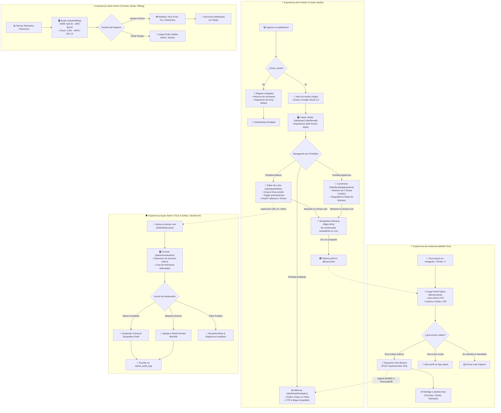

# 🗺️ Arquitectura de Información, Flujos de Usuario y Mapa de Pantallas

> **Fase SDLC**: Análisis y Diseño de Experiencia de Usuario (UI/UX)  
> **Proyecto Stitch Unificado**: `Link-in-Bio Platform` ([ID: 14141085438200447026](https://stitch.withgoogle.com))  
> **Estado**: En proceso de instanciación visual en el lienzo unificado  

---

## 1. Diagrama de Flujo de Usuario y Transiciones (User Flow)

Este diagrama modela la experiencia de extremo a extremo tanto para el **Visitante Móvil** (audiencia) como para el **Creador** (administrador):



---

## 2. Mapa del Sitio y Arquitectura de Rutas (Sitemap de 6 Pantallas)

```
/ (Landing Page Comercial)
├── /register (Registro & Reserva de Slug)
├── /login (Autenticación JWT & Google OAuth)
│
├── /@:username (Pantalla 1: Hot Path - Perfil Público Móvil)
│   └── Cache-Tag: "profile-[username]" (Revalidación bajo demanda)
│
├── /studio (Creator Studio - Protegido por JWT)
│   ├── /studio/links (Pantalla 2: Gestión de enlaces 60/40 Split & Live Preview)
│   ├── /studio/appearance (Pantalla 3: Presets de Temas Carbon, Paletas y Formas)
│   ├── /studio/analytics (Pantalla 4: Métricas en tiempo real, CTR y Geografía)
│   └── /studio/billing (Pantalla 6: SaaS Owner Tiers, MRR y Equipo)
│
└── /admin (Trust & Safety - Protegido por RBAC: SUPER_ADMIN)
    └── /admin/moderation (Pantalla 5: OneLink Sentinel AI Threat Stream & Baneo)
```

---

## 3. Matriz de Estados de Interfaz por Pantalla (Ecosistema Completo)

Para garantizar una experiencia de usuario robusta antes de programar, cada pantalla debe considerar sus 5 estados canónicos:

| Pantalla | Estado Cargando (Loading) | Estado Vacío (Empty State) | Estado Poblado (Success) | Estado Error | Interacción Optimista |
|---|---|---|---|---|---|
| **1. Perfil Público (`/@username`)** | Shimmer skeleton con formas de píldora idénticas a los botones | Mensaje amigable: *"Alex aún no ha publicado enlaces"* | Avatar, bio, redes y lista de botones con tema activo | HTTP 404: *"Perfil no encontrado o no publicado"* | Redirección instantánea sin delay mientras el beacon viaja en segundo plano |
| **2. Studio: Enlaces (`/studio/links`)** | Skeleton de tarjetas con placeholders de drag handle | Ilustración amigable: *"Agrega tu primer enlace para empezar"* | Lista de enlaces ordenables con contadores de clics y toggles | Toast rojo: *"Error al guardar reordenamiento, restaurando posición"* | Drag-and-drop inmediato en el UI y en el celular de preview; rollback si falla la red |
| **3. Studio: Apariencia (`/studio/appearance`)** | Skeleton de cuadrícula de temas con shimmer suave | N/A (Siempre hay 5 temas predefinidos cargados) | Grid interactivo con badge *"Activo"* en el tema seleccionado | Alerta inline con opción de reintentar | Cambio visual instantáneo en el mockup del smartphone derecho al hacer clic |
| **4. Studio: Analíticas (`/studio/analytics`)** | Shimmer en gráficas y tarjetas métricas | *"No hay datos aún. Comparte tu enlace para recibir visitas"* | Gráfica temporal dual (vistas vs clics) y ranking de links | Banner de error con botón de reintento | Filtro de rango de fechas (7d, 30d, 90d) con cache local |
| **5. Sentinel AI & Admin (`/admin/moderation`)** | Shimmer en telemetría de tensores y tabla de amenazas | *"Sin amenazas pendientes. Motor Sentinel 100% limpio"* | Feed de URLs sospechosas, scores (0.94 CRITICAL) y botones de ban | Alerta: *"Error al comunicar con runtime ONNX local"* | Suspensión instantánea de la UI con despublicación en segundo plano |
| **6. SaaS Billing (`/studio/billing`)** | Skeleton de tarjetas de ingresos y tabla de equipo | N/A (Planes base Free/Pro/Enterprise siempre presentes) | MRR ($18.4k), switch mensual/anual, catálogo de tiers y miembros | Banner: *"Error de webhook de Stripe, reintentando sincronización"* | Toggle instantáneo de precios y optimista de invitación de equipo |

---

## 4. El Lienzo Unificado en Google Stitch (Suite Completa de 6 Pantallas)

A diferencia de herramientas estáticas de prototipado, **Google Stitch** funciona con un concepto de **Lienzo Infinito (Infinite Canvas)** donde todo el ecosistema coexiste dentro del mismo proyecto:

```
┌────────────────────────────────────────────────────────────────────────────────────────┐
│               GOOGLE STITCH UNIFIED CANVAS (Project: 14141085438200447026)             │
│                                                                                        │
│  ┌──────────────────┐    ┌───────────────────────────────────┐    ┌─────────────────┐  │
│  │ 📱 Pantalla 1    │    │ 🖥️ Pantalla 2                     │    │ 🎨 Pantalla 3   │  │
│  │ Perfil Público   │    │ Creator Studio Dashboard          │    │ Appearance      │  │
│  │ Mobile (390px)   │    │ Desktop Split (1440px)            │    │ Customizer      │  │
│  │ [ALEX RIVERA]    │    │ [Editor 60% | Phone Preview 40%]  │    │ [Theme Presets] │  │
│  └──────────────────┘    └───────────────────────────────────┘    └─────────────────┘  │
│                                                                                        │
│  ┌──────────────────┐    ┌───────────────────────────────────┐    ┌─────────────────┐  │
│  │ 📊 Pantalla 4    │    │ 🛡️ Pantalla 5                     │    │ 👑 Pantalla 6   │  │
│  │ Performance      │    │ OneLink Sentinel & Super Admin    │    │ Founder Studio  │  │
│  │ Analytics Studio │    │ [AI Threat Stream & Baneo]        │    │ [Billing & Team]│  │
│  └──────────────────┘    └───────────────────────────────────┘    └─────────────────┘  │
│                                                                                        │
│                 Mismo Sistema de Tokens: Carbon Architecture (Zinc-950)                │
└────────────────────────────────────────────────────────────────────────────────────────┘
```

### Ventajas de Mantener Todo en el Mismo Proyecto de Stitch:
1. **Mismo Sistema de Diseño Heredado**: Todas las pantallas comparten automáticamente el mismo objeto de `theme` (colores Zinc 950 `#09090b`, Geist, JetBrains Mono, radio de píldora).
2. **Visualización Lado a Lado**: Puedes ver el perfil móvil justo al lado del panel de administración que lo edita, y al lado de las consolas de Super Admin y Facturación.
3. **Stitch vs. Figma**:
   * En Figma tienes vectores estáticos que un desarrollador debe traducir manualmente a código.
   * En Stitch cada pantalla es **código DOM real renderizado con Tailwind CSS**, por lo que los espaciados, fuentes y colores son 100% fidedignos al resultado final de producción.

