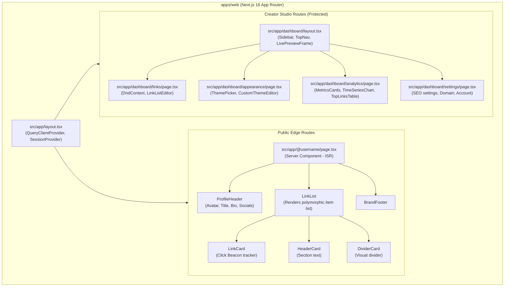

# 🎨 UI/UX Specifications, Wireframes & Mockup Architecture

> **Purpose**: Formal visual and interaction design blueprint for the Link-in-Bio platform.  
> **Status**: Ready for Review / Alignment (Compatible with Google Stitch & Figma)  
> **Target Experiences**: Mobile-first visitor landing page (`/@username`) and Responsive Creator Dashboard.  

---

## 1. Design System Tokens & Foundations

### 1.1 Color Palette Archetypes
Our platform supports curated presets and granular custom theme authoring:

| Token Category | Default Dark ("Obsidian") | Default Light ("Minimal") | Neon Glow ("Cyberpunk") | Soft Pastel ("Sakura") |
|---|---|---|---|---|
| **Background** | `#0f172a` (Slate 900) | `#f8fafc` (Slate 50) | `#09090b` (Zinc 950) | `#fff1f2` (Rose 50) |
| **Card / Surface** | `#1e293b` (Slate 800) | `#ffffff` (White) | `#18181b` (Zinc 900) | `#ffe4e6` (Rose 100) |
| **Primary Text** | `#f8fafc` (Slate 50) | `#0f172a` (Slate 900) | `#fafafa` (Zinc 50) | `#881337` (Rose 900) |
| **Secondary Text**| `#94a3b8` (Slate 400) | `#64748b` (Slate 500) | `#a1a1aa` (Zinc 400) | `#be123c` (Rose 700) |
| **Accent / Focus** | `#6366f1` (Indigo 500)| `#2563eb` (Blue 600) | `#06b6d4` (Cyan 500) | `#f43f5e` (Rose 500) |
| **Button Surface** | `#334155` (Slate 700) | `#ffffff` (White) | `#27272a` (Zinc 800) | `#ffffff` (White) |
| **Border / Stroke**| `#334155` (Slate 700) | `#e2e8f0` (Slate 200) | `#06b6d4` (Cyan Glow)| `#fecdd3` (Rose 200) |

### 1.2 Typography Hierarchy
- **Primary Body & Interface**: `Inter, system-ui, -apple-system, sans-serif`
- **Display & Headings**: `Outfit, Inter, sans-serif`
- **Supported Creator Profile Fonts**: `Inter`, `Poppins`, `Roboto`, `Outfit`, `Playfair Display`, `Space Grotesk`, `JetBrains Mono`.

### 1.3 Button Geometry Styles
1. **Filled Rounded**: `border-radius: 9999px; background: {btn_color}; color: {btn_text_color};`
2. **Sharp Outline**: `border-radius: 6px; border: 2px solid {btn_color}; background: transparent;`
3. **Hard Shadow (Retro/Brutalist)**: `border: 2px solid #000; box-shadow: 4px 4px 0px #000;`
4. **Soft Glassmorphism**: `backdrop-filter: blur(12px); background: rgba(255,255,255,0.1); border: 1px solid rgba(255,255,255,0.2);`

---

## 2. Screen-by-Screen Wireframes & Layout Blueprints

### 2.1 Public Profile Page (`/@username`) — Hot Path

The public profile is mobile-first, designed for sub-100ms first contentful paint (FCP) and zero layout shift.

```
┌──────────────────────────────────────────────┐
│                  [ 4:20 📶 🔋 ]              │
│                                              │
│                   ╭──────╮                   │
│                   │ 👤   │  Avatar (96x96px) │
│                   ╰──────╯                   │
│              Alex Rivera ⚡                  │
│       @alexrivera • Tech & Lifestyle         │
│                                              │
│      [ 📷 ]  [ 🎵 ]  [ 🐦 ]  [ 💼 ]          │ Social Icons
│                                              │
│  ┌────────────────────────────────────────┐  │
│  │ 🚀 Latest YouTube Video                │  │ Link Card
│  └────────────────────────────────────────┘  │ (Active)
│                                              │
│  ┌────────────────────────────────────────┐  │
│  │ 🛍️ My Gear & Recommended Tech          │  │
│  └────────────────────────────────────────┘  │
│                                              │
│  ─────── 📖 Reading & Courses ────────────── │ Header / Divider
│                                              │
│  ┌────────────────────────────────────────┐  │
│  │ 📚 Free System Design Cheat Sheet      │  │
│  └────────────────────────────────────────┘  │
│                                              │
│  ┌────────────────────────────────────────┐  │
│  │ ☕ Support my Work (Buy me a coffee)   │  │
│  └────────────────────────────────────────┘  │
│                                              │
│              🔗 Powered by LinkTree          │ Minimal Footer
└──────────────────────────────────────────────┘
```

---

### 2.2 Creator Dashboard — Split Screen Architecture (Desktop)

The Creator Dashboard uses a **2-Column Split-View** on desktop and a drawer/bottom-sheet preview on mobile.

```
┌─────────────────────────────────────────────────────────────────────────────────────────────────────────┐
│ 🔗 Linktree Studio        [ Links ]   [ Appearance ]   [ Analytics ]   [ Settings ]       [ Alex R. ▾ ] │
├────────────────────────────────────────────────────────────────────┬────────────────────────────────────┤
│ 🛠️ EDITING PANEL (Left Column - 60% Width)                         │ 📱 LIVE PHONE PREVIEW (Right 40%)  │
│                                                                    │                                    │
│  [ + Add New Link ]   [ + Add Header ]   [ + Add Divider ]         │           ╭────────────────╮       │
│                                                                    │           │    [ 12:00 ]   │       │
│  ┌──────────────────────────────────────────────────────────────┐  │           │     ╭────╮     │       │
│  │ ⠿ [Icon]  Latest YouTube Video                     [ 👁️ ] [⋮] │  │           │     │👤  │     │       │
│  │    https://youtube.com/watch?v=xyz123                        │  │           │     ╰────╯     │       │
│  │    📊 1,420 clicks   •   [ Edit URL ]   [ Add Thumbnail ]    │  │           │   Alex Rivera  │       │
│  └──────────────────────────────────────────────────────────────┘  │           │                │       │
│                                                                    │           │ ┌────────────┐ │       │
│  ┌──────────────────────────────────────────────────────────────┐  │           │ │ YouTube 🚀 │ │       │
│  │ ⠿ [Icon]  My Gear & Recommended Tech               [ 👁️ ] [⋮] │  │           │ └────────────┘ │       │
│  │    https://kit.co/alexrivera                                 │  │           │                │       │
│  │    📊 842 clicks     •   [ Edit URL ]   [ Add Thumbnail ]    │  │           │ ┌────────────┐ │       │
│  └──────────────────────────────────────────────────────────────┘  │           │ │ My Gear 🛍️ │ │       │
│                                                                    │           │ └────────────┘ │       │
│  ┌──────────────────────────────────────────────────────────────┐  │           │                │       │
│  │ ⠿ ─── SECTION HEADER: Reading & Courses ────────── [ 👁️ ] [⋮] │  │           │ ── Reading ─── │       │
│  └──────────────────────────────────────────────────────────────┘  │           │                │       │
│                                                                    │           │ ┌────────────┐ │       │
│  ┌──────────────────────────────────────────────────────────────┐  │           │ │ Cheat Sheet│ │       │
│  │ ⠿ [Icon]  Free System Design Cheat Sheet           [ 👁️ ] [⋮] │  │           │ └────────────┘ │       │
│  │    https://gumroad.com/l/cheatsheet                          │  │           │                │       │
│  │    📊 2,150 clicks   •   [ Edit URL ]   [ Add Thumbnail ]    │  │           │ [ Share Page ] │       │
│  └──────────────────────────────────────────────────────────────┘  │           ╰────────────────╯       │
│                                                                    │    Live synced via React state     │
└────────────────────────────────────────────────────────────────────┴────────────────────────────────────┘
```

---

### 2.3 Appearance / Theme Customizer Tab

```
┌─────────────────────────────────────────────────────────────────────────────────────────────────────────┐
│ 🎨 Appearance Settings                                                                                 │
├─────────────────────────────────────────────────────────────────────────────────────────────────────────┤
│ 1. Profile Identity                                                                                     │
│    Avatar:   [ (👤) Change Avatar ]  (Max 5MB: JPEG, PNG, WebP)                                         │
│    Title:    [ Alex Rivera                                       ]                                      │
│    Bio:      [ Software Engineer & Content Creator               ] (42 / 500)                           │
│                                                                                                         │
│ 2. Curated Themes (Click to apply instantly)                                                           │
│    ┌──────────┐  ┌──────────┐  ┌──────────┐  ┌──────────┐  ┌──────────┐                                 │
│    │ Obsidian │  │ Minimal  │  │ Cyberpunk│  │ Sakura   │  │ Forest   │                                 │
│    │  [Dark]  │  │ [Light]  │  │  [Neon]  │  │ [Pastel] │  │ [Emerald]│                                 │
│    └──────────┘  └──────────┘  └──────────┘  └──────────┘  └──────────┘                                 │
│                                                                                                         │
│ 3. Custom Styling (Pro Feature)                                                                         │
│    Background: (•) Solid Color    ( ) Gradient    ( ) Custom Image                                      │
│    Color Picker: [#0f172a] █                                                                            │
│    Button Shape: [ Rounded Pill (9999px) ▾ ]                                                            │
│    Button Color: [#334155] █      Button Text: [#ffffff] █                                              │
│    Typography:   [ Space Grotesk ▾ ]                                                                    │
└─────────────────────────────────────────────────────────────────────────────────────────────────────────┘
```

---

### 2.4 Analytics Dashboard Tab

```
┌─────────────────────────────────────────────────────────────────────────────────────────────────────────┐
│ 📊 Performance Analytics                          [ Last 7 Days ▾ ]   [ Export CSV ]                    │
├─────────────────────────────────────────────────────────────────────────────────────────────────────────┤
│  ┌──────────────────┐  ┌──────────────────┐  ┌──────────────────┐  ┌──────────────────┐                 │
│  │ Total Page Views │  │ Total Link Clicks│  │ Avg. CTR         │  │ Unique Visitors  │                 │
│  │ 24,510           │  │ 8,920            │  │ 36.4%            │  │ 18,340           │                 │
│  │ ↗ +12.4% vs lw   │  │ ↗ +8.2% vs lw    │  │ ↗ +1.8% vs lw    │  │ ↗ +15.1% vs lw   │                 │
│  └──────────────────┘  └──────────────────┘  └──────────────────┘  └──────────────────┘                 │
│                                                                                                         │
│ 📈 Views & Clicks Over Time (Hourly / Daily TimescaleDB Rollups)                                        │
│  ┌───────────────────────────────────────────────────────────────────────────────────────────────────┐  │
│  │ 3k ┤                                               ╭───╮                                          │  │
│  │ 2k ┤                       ╭──────╮               ╭╯   ╰─╮       ╭───╮                            │  │
│  │ 1k ┤     ╭───╮            ╭╯      ╰──╮           ╭╯      ╰───────╯   ╰─── (Views)                 │  │
│  │    │ ────╯   ╰────────────╯          ╰───────────╯                   ─── (Clicks)                 │  │
│  │ 0  └─┬─────────┬─────────┬─────────┬─────────┬─────────┬─────────┬─────────┬─────────┬─────────┬────┘  │
│  │     Mon       Tue       Wed       Thu       Fri       Sat       Sun                                │  │
│  └───────────────────────────────────────────────────────────────────────────────────────────────────┘  │
│                                                                                                         │
│ 🔗 Top Performing Links                       🌍 Top Geographic Locations                               │
│  1. System Design Sheet — 2,150 (24.1%)        1. United States 🇺🇸 — 42%                                 │
│  2. YouTube Video       — 1,420 (15.9%)        2. Germany 🇩🇪       — 14%                                 │
│  3. Gear Kit            —   842 (9.4%)         3. United Kingdom 🇬🇧 — 11%                                │
│  4. Buy me a coffee     —   610 (6.8%)         4. Brazil 🇧🇷        —  8%                                 │
└─────────────────────────────────────────────────────────────────────────────────────────────────────────┘
```

---

## 3. Component Hierarchy Tree (Mermaid)



---

## 4. Google Stitch / Prototyping Alignment

All 4 target views have been formally generated, tested, and stored within the unified Google Stitch project (`14141085438200447026`) and mirrored in `docs/ui-ux/mockups/`:

| Screen | Viewport | PNG Mockup | Source HTML | Stitch Screen ID |
|---|---|---|---|---|
| **1. Public Profile** (`/@alexrivera`) | Mobile 390x844 | [screen-1-profile.png](file:///c:/Users/crisa/Workspace/system-design/url-shortener/docs/ui-ux/mockups/screen-1-profile.png) | [screen-1-profile.html](file:///c:/Users/crisa/Workspace/system-design/url-shortener/docs/ui-ux/mockups/screen-1-profile.html) | `c30c125858234fca8b5fe40e4cacaf18` |
| **2. OneLink Studio (Links & Content)** | Desktop 1440p (60/40) | [screen-2-studio-dashboard.png](file:///c:/Users/crisa/Workspace/system-design/url-shortener/docs/ui-ux/mockups/screen-2-studio-dashboard.png) | [screen-2-studio-dashboard.html](file:///c:/Users/crisa/Workspace/system-design/url-shortener/docs/ui-ux/mockups/screen-2-studio-dashboard.html) | `28acc78d161d4c0e9043c33a253a6509` |
| **3. Appearance & Themes Customizer** | Desktop 1440p (60/40) | [screen-3-appearance.png](file:///c:/Users/crisa/Workspace/system-design/url-shortener/docs/ui-ux/mockups/screen-3-appearance.png) | [screen-3-appearance.html](file:///c:/Users/crisa/Workspace/system-design/url-shortener/docs/ui-ux/mockups/screen-3-appearance.html) | `b7727bd8e4194a6cb808d171e3c3d79a` |
| **4. Performance Analytics Dashboard** | Desktop 1440p (Full) | [screen-4-analytics.png](file:///c:/Users/crisa/Workspace/system-design/url-shortener/docs/ui-ux/mockups/screen-4-analytics.png) | [screen-4-analytics.html](file:///c:/Users/crisa/Workspace/system-design/url-shortener/docs/ui-ux/mockups/screen-4-analytics.html) | `abefbcf5251c48c0b9b8cbd9d4bead72` |

1. **Design Tokens Export**: All token values in Section 1 map directly to Tailwind CSS variables in `apps/web/src/app/globals.css`.
2. **Component Boundaries**: Each component (`LinkCard`, `ProfileHeader`, `LivePhonePreview`, `ThemeCard`) has strict atomic props validated with `@repo/shared` schemas.
3. **Responsive Breakpoints**:
   - `sm`: 640px (Mobile portrait to tablet)
   - `md`: 768px (Split dashboard unlocks drawer preview)
   - `lg`: 1024px (Full 60/40 desktop split dashboard with fixed phone mockup)
   - `xl`: 1280px (Wide monitor optimization)
